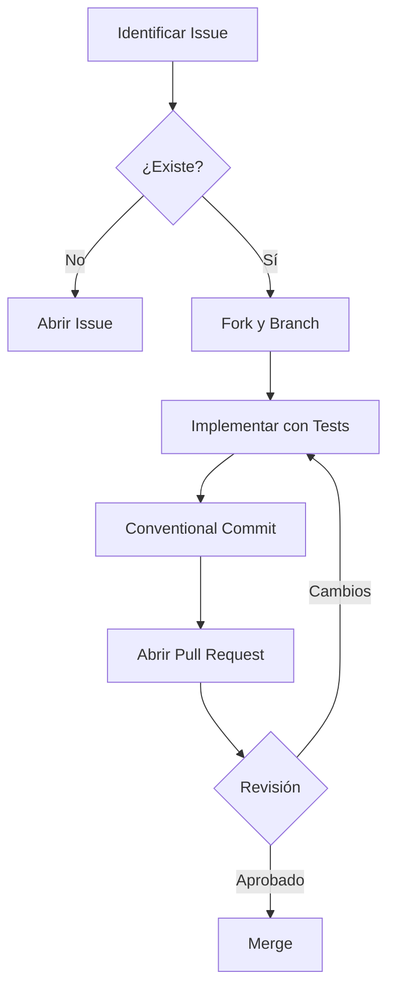

# Guía de Contribución - Recetaria API

¡Gracias por tu interés en contribuir a Recetaria! Este documento establece las reglas para colaborar en el código, mantener la calidad y asegurar que la arquitectura escale correctamente.

## 1. Interacción con Agentes de IA

Si usás copilotos o agentes (como Claude, GPT o Cursor) para proponer cambios, tené en cuenta lo siguiente:
- **Contexto Híbrido:** El repositorio cuenta con un archivo `AGENTS.md` (o `llms-full.txt`) que define la misión y límites del agente. Por favor, asegúrate de que tu agente lo lea antes de generar código.
- **Sistema de Límites "Always, Ask, Never":**
  - **Always (Siempre):** Podés automatizar linting, formateo de Markdown, generación de docstrings y bloques `try/catch` globales.
  - **Ask (Preguntar):** Debés pedir validación humana para cambios en esquemas de base de datos (`schema.prisma`) o nuevas dependencias externas en el `package.json`.
  - **Never (Nunca):** Está prohibido subir claves API, modificar el archivo `.env`, eliminar tests de integración existentes o modificar archivos en `node_modules`.

## 2. Cómo Contribuir

### 🐛 Reportar Bugs
Si encontrás un error, abrí un Issue en GitHub con la etiqueta `bug` incluyendo:
1. **Título claro:** Descripción concisa del error.
2. **Pasos para reproducir:** Lista numerada del 1 al N.
3. **Comportamiento:** Qué esperabas vs. qué pasó realmente.
4. **Entorno:** Versión de Node.js, SO, y si usaste Docker para PostgreSQL.

### 💡 Sugerir Funcionalidades
Para nuevas ideas, abrí un Issue con la etiqueta `enhancement`. Explicá el valor de negocio y a quién beneficia la propuesta (ej. Usuarios Finales, Nutricionistas, Chefs).

## 3. Flujo de Trabajo (Git Workflow)

Seguimos una convención estricta para mantener un historial limpio y automatizable:

1. **Fork & Clone:** Hacé un fork y trabajá en tu copia local.
2. **Branching:** Creá una rama descriptiva usando `tipo/nro-issue-descripcion-corta`:
  - `feat/12-recipe-filters`
  - `fix/34-jwt-expiration`
3. **Commits:** Usamos Conventional Commits:
  - `feat(recipes): agregar filtro por dificultad` (Nueva funcionalidad)
  - `fix(auth): corregir hash de bcrypt` (Corrección de bug)
  - `docs: actualizar readme con nuevos endpoints` (Documentación)

## 4. Estándares Técnicos

Para que tu código sea aceptado en el TP/Proyecto, debe cumplir con estos pilares:

- **TypeScript Estricto:** Prohibido el uso de `any`. Todo input externo (`req.body`, `req.query`, `req.params`) debe validarse con **Zod** antes de tocar la lógica de negocio.
- **Clean Code:** Código modular y funcional. Comentá el "por qué" (regla de negocio), no el "qué" (el código debe ser autoexplicativo).
- **Separación de Capas:** Respetamos la jerarquía `Router -> Controller -> Service -> Repository`.
  - El *Controller* solo maneja HTTP (req, res) y try/catch.
  - El *Service* tiene la lógica de negocio pura.
  - El *Repository* aísla a Prisma y PostgreSQL.
- **Nomenclatura:**
  - Archivos generales: `kebab-case.ts` (ej. `recipes.controller.ts`).
  - Clases / Modelos: `PascalCase` (ej. `RecipeService`).

## 5. Testing y Validación

No aprobamos Pull Requests que rompan los flujos críticos o no manejen los códigos de error HTTP adecuadamente.
- **Backend:** Tests de integración (simulando peticiones HTTP) usando Supertest y Jest/Vitest.
- **Validación Manual:** Las rutas deben estar documentadas y ser funcionales en la colección de **Thunder Client**.
- **Pre-commit:** Se recomienda usar Husky para ejecutar linting antes de cada commit.

## 6. Checklist de Pull Request

Antes de enviar tu PR, verificá que cumplas con lo siguiente:

- [ ] He leído y seguido las guías de este documento.
- [ ] Mi código sigue los estándares de nomenclatura y la arquitectura en capas.
- [ ] He encapsulado la lógica de Prisma en el repositorio correspondiente.
- [ ] Todos los tests de integración y la colección de Thunder Client pasan localmente.
- [ ] He actualizado la documentación si modifiqué endpoints o esquemas.
- [ ] El PR es pequeño y trata una sola funcionalidad/arreglo.

## Código de Conducta

Nos comprometemos a fomentar un entorno colaborativo y académico libre de acoso. La empatía es tan importante como el código limpio. 

¿Tenés dudas? Escribile al Responsable Técnico: **Facundo Nicolás González** o abrí una discusión en GitHub.

¡Gracias por ayudar a construir el futuro de este proyecto! 🚀