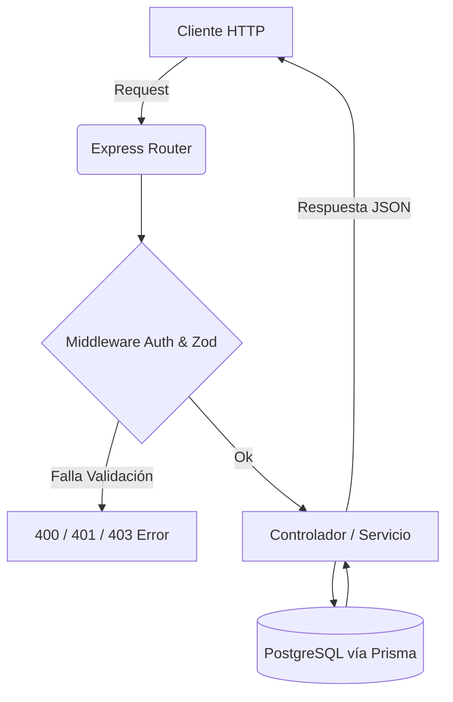

# Recetaria API (MVP Backend)

Una API RESTful robusta diseñada para centralizar recetas, cruzando contenido generado por usuarios con validación estricta de profesionales clínicos y gastronómicos.

🎥 **Demostración Visual**
*(Inserta aquí el enlace a tu video de Loom o capturas de pantalla de la colección de Thunder Client probando los endpoints).*

---

## 🚀 Quick Start

### 1. Requisitos Previos
- [Node.js] v18.0+
- [PostgreSQL] v15+ (Local o vía Docker)
- Facundo Nicolás González (Responsable del despliegue)

### 2. Instalación
Clona el repositorio y configura el entorno local:

```bash
# Clonar el repo
git clone https://github.com/[usuario]/recetaria-api.git
cd recetaria-api

# Configurar variables de entorno
cp .env.example .env

# Levantar base de datos PostgreSQL con Docker (Opción recomendada)
docker-compose up -d

# Instalar dependencias
npm install

# Ejecutar migraciones de Prisma para crear el esquema en la base de datos
npx prisma db push

# Levantar el servidor en modo desarrollo
npm run dev
```

---

## 🛠️ Guía de Uso

Ejemplo rápido de cómo autenticarse y consultar recetas usando `curl`:

```bash
# 1. Login para obtener el JWT
curl -X POST http://localhost:3000/api/v1/auth/login \
-H "Content-Type: application/json" \
-d '{"email": "usuario@test.com", "password": "password123"}'

# 2. Buscar recetas aprobadas (Usando el token obtenido)
curl -X GET "http://localhost:3000/api/v1/recipes?status=APPROVED" \
-H "Authorization: Bearer <TU_TOKEN_JWT>"
```

---

## 🏗️ Arquitectura y Stack

El proyecto sigue una arquitectura en capas por componentes (Rutas > Controladores > Servicios > Repositorios) centrada en la escalabilidad y el mantenimiento a largo plazo.

| Categoría | Tecnología | Propósito |
| :--- | :--- | :--- |
| **Lenguaje** | TypeScript | Tipado estricto, prevención de errores en tiempo de compilación y mejor DX. |
| **Framework** | Express.js | Enrutamiento ágil y ecosistema robusto de middlewares. |
| **Base de Datos** | PostgreSQL + Prisma ORM | Persistencia relacional (ACID), soporte de JSONB e integridad referencial estricta. |
| **Validación** | Zod | Validación de esquemas y sanitización de datos (Req.body / Req.query). |
| **Seguridad** | Bcrypt & JWT | Hashing de contraseñas y autenticación *stateless*. |

### Diagrama de Flujo de Petición



---

## 📂 Documentación de la API

| Método | Endpoint | Descripción | Auth (Roles) |
| :--- | :--- | :--- | :--- |
| POST | `/api/v1/auth/register` | Crea un nuevo usuario en el sistema. | No |
| POST | `/api/v1/auth/login` | Autentica al usuario y devuelve un JWT. | No |
| GET | `/api/v1/recipes` | Lista recetas con filtros (ej: `?difficulty=EASY`). | No |
| GET | `/api/v1/recipes/:id` | Obtiene el detalle de una receta específica. | No |
| POST | `/api/v1/recipes` | Crea una receta nueva (Estado: DRAFT). | Sí (USER, CHEF, NUTR.) |
| PUT | `/api/v1/recipes/:id` | Actualiza una receta (Idempotente). | Sí (Autor) |
| DELETE| `/api/v1/recipes/:id` | Elimina una receta. | Sí (Autor o ADMIN) |
| PUT | `/api/v1/recipes/:id/approve`| Aprueba una receta (Cambio de estado). | Sí (CHEF, NUTRITIONIST)|

> [!TIP]
> Para una referencia exhaustiva, importa el archivo `Thunder Client Collection.json` incluido en la carpeta `/docs` de este repositorio directamente en tu extensión de VS Code.

---

## 🤝 Contribución

¡Las contribuciones son lo que hacen a la comunidad de código abierto un lugar increíble!

1. Realiza un Fork del proyecto.
2. Crea una Rama para tu mejora (`git checkout -b feature/MejoraIncreible`).
3. Realiza un Commit (`git commit -m 'feat: añadí filtro nutricional'`).
4. Haz Push a la rama (`git push origin feature/MejoraIncreible`).
5. Abre un Pull Request.

---

## 📄 Licencia

Este proyecto es de carácter académico (Bootcamp) y se distribuye bajo la Licencia MIT. Para más información, consulta el archivo `LICENSE`.

⭐ *Si esta arquitectura te resultó útil, considera darle una estrella en GitHub.*