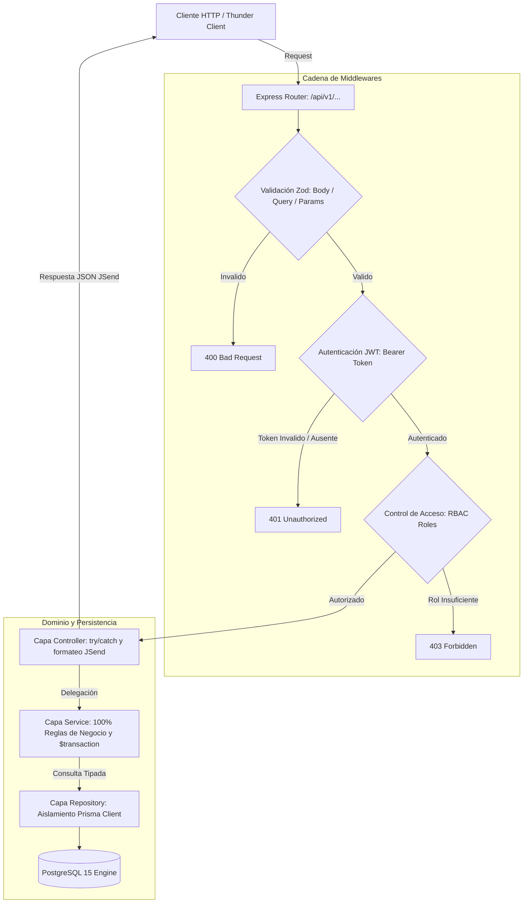

# Recetaria API (MVP Backend)

Una API RESTful robusta y escalable diseñada para centralizar recetas gastronómicas, cruzando contenido generado por los usuarios (UGC) con validación clínica y culinaria estricta por parte de profesionales de la salud y chefs mediante un sistema de control de acceso basado en roles (RBAC).

🎥 **Demostración Visual:** *(Inserta aquí el enlace a tu video de Loom o capturas de pantalla de la colección de Thunder Client probando los endpoints).*

---

## 🚀 Quick Start

### 1. Requisitos Previos
- [Node.js](https://nodejs.org/) v22 LTS (recomendado `>=22.12.0` o `>=20.19.0`)
- [Docker Desktop](https://www.docker.com/products/docker-desktop/) con Docker Compose v2+
- [Git](https://git-scm.com/)

---

### 2. Instalación y Configuración Inicial

Clona el repositorio y configura las variables de entorno locales:

```bash
# 1. Clonar el repositorio
git clone https://github.com/zgfnicolas/recetaria.git
cd recetaria

# 2. Configurar variables de entorno desde la plantilla segura
cp .env.example .env

# 3. Instalar dependencias
npm install
```

---

### 3. Modos de Ejecución Local

Puedes elegir entre dos flujos de trabajo según tu preferencia:

#### Opción A: Flujo Híbrido (Recomendado para el día a día)
Levanta la base de datos PostgreSQL en Docker y ejecuta la API directamente en tu máquina a máxima velocidad:

```bash
# 1. Levantar PostgreSQL 15 en segundo plano (con esquema y tablas iniciales automáticas)
npm run docker:db

# 2. Iniciar el servidor API en Windows con recarga en caliente (Hot-Reload)
npm run dev
```
> La API estará escuchando en `http://localhost:3000` y la base de datos en `127.0.0.1:5432`.

#### Opción B: Entorno 100% Contenerizado (Docker Compose)
Levanta tanto la API como PostgreSQL dentro de contenedores Docker aislados:

```bash
# Levantar la API y PostgreSQL con hot-reload (combina compose.yaml + compose.override.yaml)
npm run docker:dev

# (Opcional) Levantar además el visor web de base de datos Adminer (http://127.0.0.1:8080)
npm run docker:debug

# Probar la imagen final inmutable tal como correría en producción
npm run docker:prod

# Detener los contenedores y liberar recursos (los datos de la BD se preservan)
npm run docker:down
```

---

## 📜 Scripts Disponibles (`package.json`)

| Script | Comando Real | Propósito |
| :--- | :--- | :--- |
| `npm run dev` | `ts-node-dev --respawn ...` | Inicia la API en desarrollo con recarga en caliente (*hot-reload*). |
| `npm run build` | `tsc` | Compila TypeScript a JavaScript estándar en `dist/` verificando tipos. |
| `npm start` | `node dist/index.js` | Ejecuta el artefacto compilado en producción con Node.js puro. |
| `npm run docker:db` | `docker compose up -d postgres` | Enciende únicamente el contenedor de PostgreSQL 15 en segundo plano. |
| `npm run docker:dev` | `docker compose up --build` | Levanta todo el stack (API + BD) en Docker con recarga en vivo. |
| `npm run docker:debug` | `docker compose --profile debug up -d` | Levanta PostgreSQL y la interfaz web SQL **Adminer** en el puerto 8080. |
| `npm run docker:prod` | `docker compose -f compose.yaml up ...` | Levanta la imagen endurecida de producción (`read_only`, sin puertos expuestos). |
| `npm run docker:down` | `docker compose down` | Detiene y remueve los contenedores y redes (preservando los datos). |
| `npm run docker:config` | `docker compose config -q` | Valida la sintaxis de los archivos YAML de Docker y las variables de entorno. |

---

## 🛠️ Guía de Consumo Rápido (`curl`)

Ejemplo de cómo registrarse, autenticarse y consultar recetas protegidas:

```bash
# 1. Login para obtener el Bearer Token JWT
curl -X POST http://localhost:3000/api/v1/auth/login \
  -H "Content-Type: application/json" \
  -d '{"email": "usuario@test.com", "password": "password123"}'

# 2. Consultar recetas aprobadas por profesionales (Enviando el token)
curl -X GET "http://localhost:3000/api/v1/recipes?status=APPROVED&difficulty=EASY" \
  -H "Authorization: Bearer <TU_TOKEN_JWT>"
```

---

## 🏗️ Arquitectura y Stack Tecnológico

El proyecto implementa una arquitectura monolítica modular en 4 capas desacopladas (**Router ➔ Middlewares ➔ Controller ➔ Service ➔ Repository ➔ PostgreSQL**), garantizando tipado estático riguroso y aislamiento total de la persistencia frente a las reglas de negocio.

| Categoría | Tecnología | Propósito |
| :--- | :--- | :--- |
| **Lenguaje** | TypeScript 7+ | Tipado estricto (prohibición de `any`), seguridad en tiempo de compilación. |
| **Framework** | Express.js 5+ | Enrutamiento semántico REST y canalización de middlewares. |
| **Base de Datos** | PostgreSQL 15+ & Prisma ORM | Persistencia relacional (ACID), metadatos en `JSONB`, triggers automáticos. |
| **Validación** | Zod 4+ | Esquemas de validación estricta y sanitización de entrada antes del controlador. |
| **Seguridad** | Bcrypt 6 & JWT | Hashing seguro de contraseñas (salt rounds >= 10) y tokens sin estado (stateless). |
| **Contenedores** | Docker & Compose v2 | Entornos reproducibles, multi-stage builds (`bookworm-slim`), defensa en profundidad. |

### Diagrama de Flujo de Peticiones



---

## 📁 Estructura del Repositorio

```
📦 recetaria/
├── 📄 CLAUDE.md                             # Contexto y directivas para Claude Code (<200 líneas)
├── 📄 AGENTS.md                             # Gobernanza canónica del sistema (Always, Ask, Never)
├── 📄 llm.txt                               # Resumen conceptual hiper-denso para LLMs
├── 📄 llms-full.txt                         # Corpus técnico consolidado de contexto
├── 📄 architecture.md                       # Especificación macro de arquitectura y contrato JSend
├── 📄 instructions.md                       # Directivas canónicas operativas para IDEs
├── 📄 Dockerfile                            # Multi-stage build (base, dependencies, dev, build, prod)
├── 📄 compose.yaml                          # Baseline de producción (read_only, cap_drop ALL, red interna)
├── 📄 compose.override.yaml                 # Configuración de desarrollo local (hot-reload, puertos seguros)
├── 📄 .dockerignore                         # Exclusiones de contexto para Docker BuildKit
├── 📄 .env.example                          # Plantilla segura de variables de entorno
├── 📄 database_schema_init.sql              # Esquema SQL relacional inicial (PostgreSQL DDL)
├── 📄 prisma.config.ts                      # Configuración de Prisma y sincronización de skills IA
├── 📁 .ai/                                  # Arsenal táctico agéntico (skills, agents_custom, prompts)
├── 📁 .claude/                              # Ecosistema Claude (rules, skills, agents, hooks)
└── 📁 docs/                                 # Documentación técnica y especificaciones del sistema
    ├── 📄 prd.md                            # Documento de Requerimientos del Producto (MVP)
    ├── 📄 srs.md                            # Especificación de Requerimientos de Software (IEEE)
    ├── 📄 product_roadmap.md                # Hoja de ruta tecnológica en 4 fases
    ├── 📄 plan_de_pruebas.md                # Plan integral de aseguramiento de calidad (QA)
    ├── 📁 architecture/                     # Decisiones arquitectónicas detalladas
    │   ├── 📄 sad.md                        # Documento de Arquitectura de Software
    │   ├── 📄 diccionario_de_datos.md       # Diccionario de datos, tablas, índices y triggers
    │   └── 📄 tecnica_de_api_y_contrato_de_integracion.md # Contrato de integración API v1
    ├── 📁 rules/                            # Reglas de negocio e invariantes
    │   ├── 📄 matriz_de_perfiles_de_usuarios.md # Matriz RBAC y Personas
    │   ├── 📄 reglas_de_negocio_recetas.md  # Ciclo de vida y transiciones de estado de recetas
    │   └── 📄 politica_de_seguridad_y_privacidad.md # Privacy by Design y normativas
    ├── 📁 modules/                          # Especificación por componente de código
    │   ├── 📄 modulo_auth.md                # Contratos y firmas de Auth
    │   └── 📄 modulo_recipes.md             # Contratos y firmas de Recipes
    └── 📁 plan/                             # Orquestación activa de tareas (HITL)
        └── 📄 2026-11-07_setup_entorno_skl_pro_001.md
```

---

## 📂 Catálogo de Endpoints (`/api/v1`)

| Método | Endpoint | Descripción | Roles Requeridos |
| :--- | :--- | :--- | :--- |
| `POST` | `/api/v1/auth/register` | Registro de usuario (hash con Bcrypt). | Público |
| `POST` | `/api/v1/auth/login` | Autenticación y emisión de Bearer JWT. | Público |
| `GET` | `/api/v1/recipes` | Listado general con soporte de filtros (`?difficulty=EASY&status=APPROVED`). | Público |
| `GET` | `/api/v1/recipes/:id` | Detalle completo de una receta por UUID. | Público |
| `POST` | `/api/v1/recipes` | Crea una nueva receta (Estado inicial: `DRAFT`). | `USER`, `CHEF`, `NUTRITIONIST` |
| `PUT` | `/api/v1/recipes/:id` | Actualización de receta propia (Idempotente). | Autor (Owner) |
| `DELETE`| `/api/v1/recipes/:id` | Eliminación de receta. | Autor o `ADMIN` |
| `PUT` | `/api/v1/recipes/:id/approve` | Aprueba receta y registra evento en `audit_logs` transaccional. | `CHEF`, `NUTRITIONIST` |

> [!TIP]
> Para una referencia interactiva completa, importa la colección de **Thunder Client** incluida en este repositorio para probar de forma inmediata todos los endpoints con casos de éxito y errores HTTP.

---

## 🤝 Contribución y Normas de la Comunidad

¡Agradecemos el interés en colaborar con Recetaria! Para mantener un entorno seguro y profesional:

1. Lee nuestro [Código de Conducta](file:///C:/Users/Facundo/dev/recetaria/CODE_OF_CONDUCT.md).
2. Consulta la [Guía de Contribución](file:///C:/Users/Facundo/dev/recetaria/CONTRIBUTING.md) para conocer el flujo de trabajo de Git, ramas y commits semánticos (*Conventional Commits*).
3. Abre un Issue o Pull Request siguiendo las plantillas del repositorio.

---

## 📄 Licencia

Este proyecto se distribuye bajo la Licencia MIT. Consulta el archivo [LICENSE.md](file:///C:/Users/Facundo/dev/recetaria/LICENSE.md) para más información.

---

⭐ *Si esta arquitectura te resultó útil, considera darle una estrella en GitHub.*
