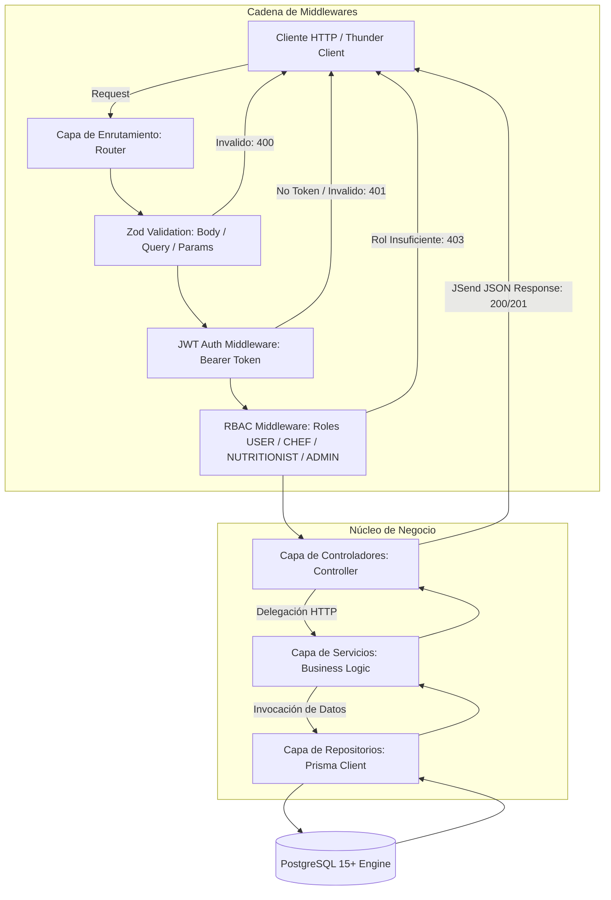

# Arquitectura del Sistema (Recetaria API)

| Metadata | Valor |
| :--- | :--- |
| **Proyecto** | Recetaria (Fase 1: MVP Backend API) |
| **Versión** | 1.0.0 |
| **Patrón Arquitectónico** | Monolito Modular en Capas (Layered Architecture) |
| **Stack Principal** | Node.js, Express, TypeScript, PostgreSQL, Prisma ORM, Zod, JWT |
| **Estándar** | SKL-PRO-001 (Nivel 1: Raíz Consciente) |

---

## 1. Visión General de la Arquitectura

Recetaria implementa una arquitectura monolítica en capas desacopladas organizada por componentes funcionales (*features*). El diseño garantiza la separación estricta de responsabilidades, previsibilidad en el flujo de ejecución, tipado estático riguroso y aislamiento completo de la base de datos respecto a las reglas de negocio.



---

## 2. Responsabilidades y Reglas de Capas

### 2.1. Capa de Rutas (`routes/`)
- Mapea las URLs REST semánticas (`/api/v1/...`).
- Aplica secuencialmente la tubería de middlewares: validación de esquemas Zod primero, autenticación JWT después, y control de roles RBAC al final.
- **Regla:** Ninguna lógica de negocio ni manipulación de datos vive en esta capa.

### 2.2. Capa de Middlewares (`middlewares/`)
- **`validate.middleware.ts`**: Intercepta `req.body`, `req.query` y `req.params`, validándolos contra esquemas de Zod. Si falla, corta el flujo con `400 Bad Request` detallando los errores.
- **`auth.middleware.ts`**: Verifica y decodifica el JSON Web Token de los encabezados `Authorization: Bearer <token>`, inyectando el usuario en el contexto `req.user = { id, role }`.
- **`rbac.middleware.ts`**: Evalúa si el `role` del usuario autenticado cumple con la lista de roles permitidos para la operación. Si no, emite `403 Forbidden`.

### 2.3. Capa de Controladores (`controllers/`)
- Interfaz entre el protocolo HTTP de Express y la lógica del sistema.
- Extrae parámetros sanitizados de la petición (`req.params`, `req.body`, `req.query`, `req.user`).
- Delega el procesamiento a la capa de Servicios correspondiente.
- Envuelve toda la ejecución en bloques `try/catch` obligatorios y formatea las respuestas bajo el contrato unificado JSend.

### 2.4. Capa de Servicios (`services/`)
- Contiene **el 100% de las reglas e invariantes de negocio**.
- Valida condiciones lógicas (ej. verificar si una receta está en estado `PENDING_REVIEW` antes de permitir su aprobación).
- Orquesta transacciones atómicas de base de datos (`prisma.$transaction`) cuando múltiples tablas se ven afectadas (ej. actualizar estado de receta e insertar registro en `audit_logs`).
- **Regla de Oro Inviolable:** La capa de Servicio **nunca debe instanciar ni llamar a Prisma directamente**. Debe interactuar exclusivamente a través de la Capa de Repositorios.

### 2.5. Capa de Repositorios (`repositories/`)
- Aísla la tecnología de persistencia (Prisma Client / PostgreSQL).
- Expone métodos fuertemente tipados (`findById`, `findAll`, `create`, `update`, `delete`, `findByEmail`, etc.).
- Si en el futuro se sustituye Prisma o PostgreSQL, la capa de Servicios no sufre modificaciones.

---

## 3. Contrato de Respuesta Universal (JSend Extendido)

Toda salida de la API se estructura de forma homogénea:

### Respuesta Exitosa (200 OK, 201 Created)
```json
{
  "success": true,
  "statusCode": 200,
  "data": {
    "id": "a1b2c3d4-e5f6-7890-abcd-ef1234567890",
    "title": "Tarta Sin TACC",
    "status": "APPROVED"
  },
  "message": "Receta obtenida exitosamente"
}
```

### Respuesta de Error (400, 401, 403, 404, 409, 500)
```json
{
  "success": false,
  "statusCode": 400,
  "message": "Error de validación en la solicitud",
  "errors": [
    {
      "field": "prepTimeMinutes",
      "message": "El tiempo de preparación debe ser mayor a 0"
    }
  ]
}
```

---

## 4. Antipatrones Prohibidos

1. **Invocación directa de Prisma desde Servicios o Controladores:** Rompe el patrón Repository e impide la creación de tests unitarios puros con mocks.
2. **Uso de tipo `any` en TypeScript:** Todo payload, entidad y parámetro debe tiparse estrictamente mediante interfaces o tipos inferidos de Zod (`z.infer<typeof schema>`).
3. **Manejo de estados sin transacción:** Modificar una entidad crítica sin persistir simultáneamente su log de auditoría en la misma transacción ACID.
4. **Almacenamiento de secretos en código:** Cualquier clave, secreto JWT o credencial de base de datos debe ser inyectada exclusivamente mediante `process.env`.
