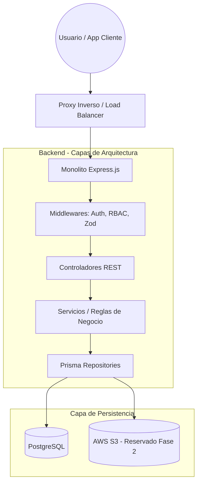
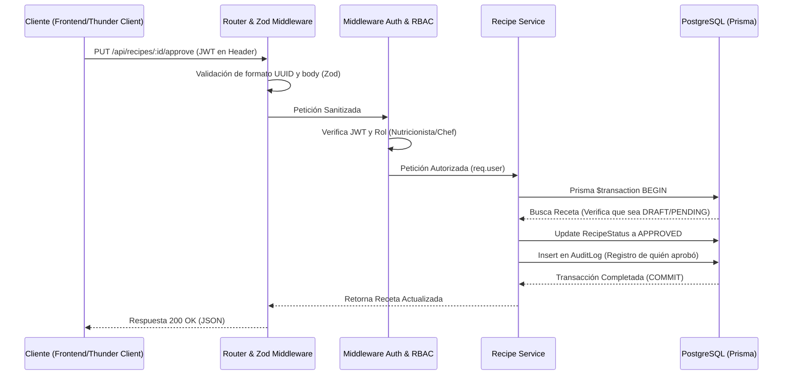

### Identificación del Proyecto

| Campo | Detalles |
| --- | --- |
| **Nombre del Proyecto** | Recetaria (Fase 1: MVP Backend API) |
| **Versión / Revisión** | 1.0.0 |
| **Fecha de Creación** | 06/11/2026 |
| **Estado** | En Revisión |
| **Responsable Técnico** | Facundo Nicolás González |
| **Fecha de Última Revisión** | 06/11/2026 |
| **Recursos** | Trabajo práctico integrador |

### 2. Arquitectura de Infraestructura

Basado en una arquitectura modular por componentes (Features) para garantizar la mantenibilidad y cumplir con los requisitos académicos de la primera fase, sentando bases para un despliegue cloud serverless o en contenedores (ej. Render/Railway). El enfoque se centra en la separación estricta de responsabilidades (Rutas, Controladores, Servicios y Repositorios).

**2.1 Diagrama de Infraestructura (Mermaid)**

### 3. Datos y persistencia

La estrategia de persistencia resuelve el dilema SQL vs NoSQL optando por un modelo híbrido en un motor relacional sólido, garantizando ACID para transacciones críticas (auditoría, RBAC), pero utilizando columnas desnormalizadas para flexibilizar la lectura de metadatos.

| Componente | Tipo / Motor | Justificación Técnica |
| --- | --- | --- |
| **Almacenamiento Principal** | PostgreSQL (Relacional) | Integridad referencial estricta para relaciones `Recipe`-`User`. Soporte nativo para `JSONB` (datos nutricionales) y arrays. |
| **ORM y Acceso a Datos** | Prisma ORM | Seguridad de tipos end-to-end con TypeScript, migraciones declarativas y `Connection Pooling` nativo integrado. |
| **Caché / Estado** | Stateless (JWT) | Diseño de Backend 100% Stateless. El estado de sesión reside en el token firmado para evitar consultas innecesarias en el MVP. |
| **Bus de Eventos (Fase 2)** | Auditoría Síncrona (Actual) | En el MVP, los logs de auditoría se guardan en la misma transacción ACID de Prisma. |

**3.1 Modelo de datos y resiliencia**
Se implementan directrices de seguridad siguiendo el OWASP Top 10, validando la integridad y sanidad de todos los payloads de entrada mediante Zod antes de que toquen la lógica de negocio. Se utiliza el Connection Pooling de Prisma para manejar picos de latencia en la base de datos sin agotar las conexiones TCP del servidor.

### 4. Flujos de datos

Definición de los protocolos de transporte bajo el estándar HTTP/1.1 para la API RESTful. Los payloads se transmiten exclusivamente en `application/json`.

**4.1 Diagrama de secuencia de datos (Mermaid)**

Este diagrama representa cómo viaja la información durante una operación crítica: **Aprobación de una receta por parte de un Nutricionista (Validación RBAC y Auditoría Transaccional).**

### 5. Seguridad y operaciones

El sistema integra "Privacy by Design" y cumplimiento de estándares de seguridad desde su concepción, satisfaciendo los criterios de evaluación.

* **Autenticación y Autorización:** Uso de JSON Web Tokens (JWT) firmados. Las contraseñas nunca se almacenan en texto plano, utilizando Bcrypt con un *salt round* adecuado.
* **Gestión de Secretos:** Cadenas de conexión (DATABASE_URL) y firmas (JWT_SECRET) aisladas en variables de entorno mediante `dotenv`, nunca versionadas en el repositorio.
* **Resiliencia (Manejo de Errores):** Implementación de un bloque `try/catch` global o *wrapper* asíncrono en todos los controladores. Middleware global de manejo de errores de Express para devolver códigos HTTP estandarizados (400, 401, 403, 404, 500) sin filtrar *stack traces* en producción.
* **CI/CD & Calidad:** Tipado estricto con TypeScript. Todas las operaciones CRUD serán sometidas a pruebas de integración con Thunder Client/Supertest, capturando casos de éxito y de fallo deliberado (ej. envío de token expirado o rol insuficiente).

### 6. Apéndices y referencias

| Referencia | Título del Recurso | Enlace / Ubicación |
| --- | --- | --- |
| **[REF-01]** | Consigna TP Integrador | `TP integrador - Tu propia API REST_1.pdf` |
| **[REF-02]** | Documentación de API | Exportación `Thunder Client Collection.json` (A entregar) |
| **[REF-03]** | Repositorio Base de Datos | `prisma/schema.prisma` |

**Nota:** Este documento es iterativo. Los requisitos marcados en la Fase 1 (Autenticación, CRUD, Middlewares, PostgreSQL) son **No negociables** para la entrega de la semana 2. Las optimizaciones (S3, Redis, Microservicios) quedan categorizadas como deuda técnica planificada para iteraciones post-bootcamp.

**Responsable del modelo:** Facundo Nicolás González
**Fecha de revisión:** 06/11/2026
**Documentos de referencia:** Trabajo práctico integrador