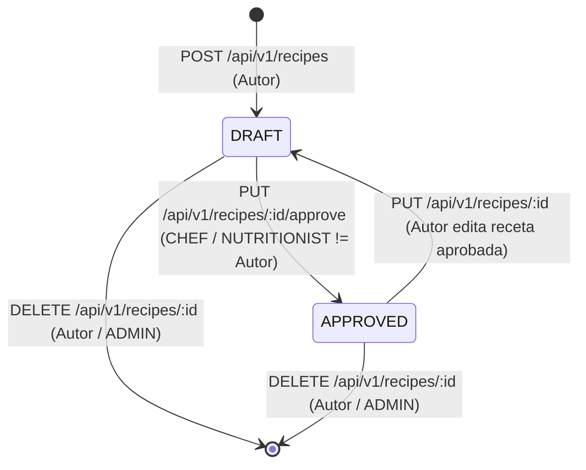

# Reglas de negocio

## Recetas

### RN-01 — Estado inicial, autoría y slug automático
Toda receta creada mediante `POST /api/v1/recipes` nace en estado `DRAFT`, asigna `authorId` exclusivamente desde el usuario autenticado (`req.user.id`) y genera automáticamente su `slug` único en formato `<titulo-normalizado-ascii>-<8-hex>` (minúsculas, sin tildes ni `ñ`, truncado a ≤ 200 caracteres, sufijo aleatorio `crypto.randomBytes(4).toString("hex")`) a partir de `title`.
- Origen: requisito funcional del MVP y control de identidad
- Se aplica en: `RecipeService.create()`

### RN-02 — Propiedad exclusiva de edición y reinicio a borrador
Solo el autor original (`recipe.authorId === req.user.id`) puede modificar su receta mediante `PUT /api/v1/recipes/:id` (payload parcial o completo con al menos 1 campo válido); cualquier otro usuario recibe `403 Forbidden`. Si la receta estaba en estado `APPROVED`, la edición la devuelve automáticamente a `DRAFT`, limpia `reviewedById` y `publishedAt`, regenera el `slug` si cambió el `title`, y registra `action = 'RESET_TO_DRAFT'` (`entityName = 'Recipe'`) en `audit_logs` dentro de `prisma.$transaction`. Si la receta ya estaba en `DRAFT`, se actualiza normalmente sin insertar un registro en `audit_logs`. La decisión de reiniciar se toma sobre la fila bloqueada (`SELECT … FOR UPDATE`) dentro de la transacción, de modo que una aprobación concurrente nunca deja `APPROVED` un contenido editado sin revisar. Solo se actualizan los campos enviados (sin defaults); `null` vacía únicamente los opcionales (`nutritionalInfo`, `coverImageUrl`, `videoUrl`). El registro guarda en `oldValues`/`newValues` el ciclo de vida (`status`, `reviewedById`, `publishedAt`) y en `newValues.changedFields` la lista ordenada de campos editados (incluye `slug` cuando se regenera por un cambio de `title`), sin duplicar su contenido. Toda edición de una receta `APPROVED` la reinicia, aunque los valores enviados coincidan con los actuales.
- Origen: integridad de autoría y preservación de la validez clínica tras modificaciones
- Se aplica en: la política pura `canEdit()` (`src/modules/recipes/recipe.policy.ts`), `RecipeService.update()` y `RecipeRepository.updateWithOptionalReset()`

### RN-03 — Borrado físico autorizado con trazabilidad
Solo el autor original (`recipe.authorId === req.user.id`) o un usuario con rol `ADMIN` pueden eliminar una receta (`DELETE /api/v1/recipes/:id`), devolviendo `403 Forbidden` en otro caso y `404 Not Found` si no existe. La eliminación física se ejecuta dentro de `prisma.$transaction` insertando previamente en `audit_logs` un registro con `action = 'DELETE'` y `oldValues` (snapshot de `title`, `authorId`, `status`). Además, no se permite eliminar físicamente un usuario que tenga recetas asociadas (`ON DELETE RESTRICT`).
- Origen: requisito CRUD del TP, moderación de plataforma y trazabilidad de auditoría
- Se aplica en: `RecipeService.delete()` y `RecipeRepository.deleteWithAudit()`

### RN-04 — Validación profesional exclusiva y prevención de doble aprobación
Únicamente los usuarios autenticados con rol `CHEF` o `NUTRITIONIST` pueden aprobar una receta (`PUT /api/v1/recipes/:id/approve`); un rol `USER` o `ADMIN` recibe `403 Forbidden`. Si la receta ya se encuentra en estado `APPROVED`, el servicio rechaza la operación con `409 Conflict`.
- Origen: propuesta de valor clínica y gastronómica de Recetaria
- Se aplica en: `rbacMiddleware(RECIPE_APPROVER_ROLES)` (`['CHEF', 'NUTRITIONIST']`), la política pura `canApprove()` (`src/modules/recipes/recipe.policy.ts`) y `RecipeService.approve()`; la doble aprobación concurrente se resuelve con el `UPDATE` condicional `status = 'DRAFT'` de `RecipeRepository.approveWithAudit()` (`409`)

### RN-05 — Separación de funciones en aprobación
Quien crea una receta no puede aprobarla (`recipe.authorId !== reviewerId`). Cualquier intento de auto-aprobación devuelve `403 Forbidden`.
- Origen: auditoría independiente y prevención de auto-validación
- Se aplica en: `canApprove()` + `RecipeService.approve()`, con defensa en profundidad en la base (`CHECK chk_recipes_reviewer_not_author`)

### RN-06 — Trazabilidad transaccional en cambios críticos
Las operaciones de aprobación (`APPROVE`), reinicio por edición desde `APPROVED` (`RESET_TO_DRAFT`) y eliminación (`DELETE`) deben ejecutarse dentro de una transacción ACID (`prisma.$transaction`) que garantice consistencia entre `recipes` y `audit_logs` usando siempre `entityName = 'Recipe'`.
- Origen: trazabilidad profesional y auditoría inmutable
- Se aplica en: `RecipeRepository.approveWithAudit()`, `RecipeRepository.updateWithOptionalReset()` y `RecipeRepository.deleteWithAudit()`

### RN-07 — Validaciones de dominio en servicio
Además de la validación estructural estricta con Zod 4 (`z.strictObject`) en el middleware, `RecipeService` exige explícitamente que `prepTimeMinutes` sea un entero entre `1` y `1440` (24 horas) y que `ingredients` incluya al menos un ingrediente y que **cada** ingrediente tenga `quantity > 0`, acumulando todos los incumplimientos en un único `400 Bad Request`.
- Origen: requisito 5 de la consigna (validaciones de negocio en capa de servicio) y constraint SQL `chk_prep_time_positive`
- Se aplica en: `RecipeService.create()` y `RecipeService.update()`

## Estados de una receta

## Usuarios y Autenticación

### RN-08 — Identificación única, cuentas activas y resguardo de credenciales
Cada usuario se identifica de forma única por su `email` (`409 Conflict` si ya existe). La contraseña nunca se almacena ni se registra en logs en texto plano: se cifra con Bcrypt usando al menos `10` *salt rounds*. En `POST /api/v1/auth/login`, los usuarios inactivos (`isActive === false`), correos inexistentes o claves erróneas reciben el mismo `401 Unauthorized` genérico (comparación timing-safe contra hash ficticio cuando no existe el email) sin revelar causa específica; `authMiddleware` permanece 100 % stateless en el MVP. Contra fuerza bruta y *credential stuffing*, `POST /api/v1/auth/login` admite como máximo **10 intentos fallidos por IP** y **20 por cuenta** (email normalizado) cada 15 minutos —los inicios de sesión exitosos no consumen cuota— y `POST /api/v1/auth/register` admite **5 solicitudes por hora por IP**; al superarlos se responde `429 Too Many Requests` con el mismo mensaje genérico exista o no la cuenta, sin llegar a consultar la base ni a ejecutar Bcrypt.
- Origen: buenas prácticas OWASP y protección de identidad
- Se aplica en: `AuthService.register()`, `AuthService.login()` y los rate limits de `createAuthRouter` (`src/modules/auth/auth.rate-limit.ts`)
