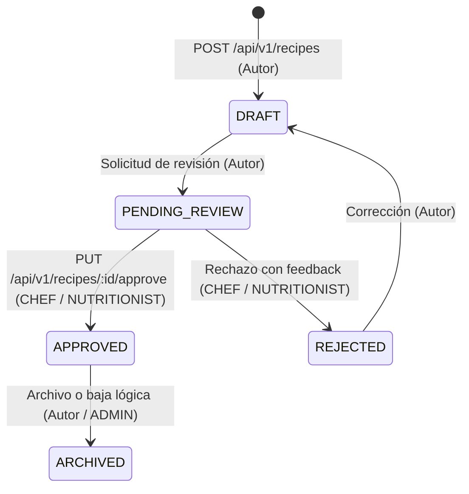

# Reglas de negocio

## Recetas

### RN-01 — Estado inicial y autoría obligatoria
Toda receta creada mediante `POST /api/v1/recipes` nace en estado `DRAFT` y su `authorId` se asigna exclusivamente desde el usuario autenticado en el token JWT (`req.user.id`). No se permite crear recetas a nombre de terceros.
- Origen: requisito funcional del MVP y control de identidad
- Se aplica en: `RecipeService.create()`

### RN-02 — Propiedad exclusiva de edición
Solo el autor original de la receta (`recipe.authorId === req.user.id`) puede modificar su contenido mediante `PUT /api/v1/recipes/:id`. Cualquier intento de otro usuario devuelve `403 Forbidden`.
- Origen: integridad de autoría del contenido
- Se aplica en: `RecipeService.update()`

### RN-03 — Restricción de borrado e integridad referencial
Solo el autor original (`recipe.authorId === req.user.id`) o un usuario con rol `ADMIN` pueden eliminar una receta. Asimismo, no se puede eliminar físicamente un usuario que tenga recetas asociadas (`ON DELETE RESTRICT`).
- Origen: moderación de plataforma y preservación del catálogo
- Se aplica en: `RecipeService.delete()` y restricción FK `fk_recipes_author` en PostgreSQL

### RN-04 — Validación profesional exclusiva
Únicamente los usuarios autenticados con rol `CHEF` o `NUTRITIONIST` pueden ejecutar la aprobación de una receta (`PUT /api/v1/recipes/:id/approve`). Un usuario `USER` o `ADMIN` recibe `403 Forbidden`.
- Origen: propuesta de valor clínica y gastronómica de Recetaria
- Se aplica en: `rbacMiddleware(['CHEF', 'NUTRITIONIST'])` y `RecipeService.approve()`

### RN-05 — Separación de funciones en aprobación
Quien carga o crea una receta no puede validarla ni aprobarla (`recipe.authorId !== reviewerId`).
- Origen: auditoría independiente y prevención de auto-validación
- Se aplica en: `RecipeService.approve()`

### RN-06 — Trazabilidad transaccional de aprobación
La transición a estado `APPROVED` debe ejecutarse dentro de una única transacción ACID (`prisma.$transaction`) que actualice `recipes.status`, asigne `recipes.reviewedById` y `publishedAt`, e inserte un registro inmutable en `audit_logs` (`entityName = 'Recipe'`, `action = 'APPROVE'`).
- Origen: trazabilidad legal y clínica ante cambios de estado
- Se aplica en: `RecipeRepository.approveWithAudit()` invocada por `RecipeService.approve()`

### RN-07 — Invariantes de contenido de receta
Toda receta válida debe tener un `prepTimeMinutes` entero mayor a `0`, un `slug` único y al menos un ingrediente estructurado (`name`, `quantity > 0`, `unit`) en `ingredients`.
- Origen: consistencia de dominio y estructura de datos
- Se aplica en: `createRecipeSchema` (Zod) y restricción SQL `chk_prep_time_positive`

## Estados de una receta

## Usuarios y Autenticación

### RN-08 — Identificación única y resguardo de credenciales
Cada usuario se identifica de forma única por su `email`. La contraseña nunca se almacena ni se registra en logs en texto plano: se cifra con Bcrypt usando al menos 10 *salt rounds* antes de persistir, y los errores de login devuelven `401 Unauthorized` genérico sin revelar si falló el email o la clave.
- Origen: buenas prácticas OWASP y protección de identidad
- Se aplica en: `AuthService.register()` y `AuthService.login()`
