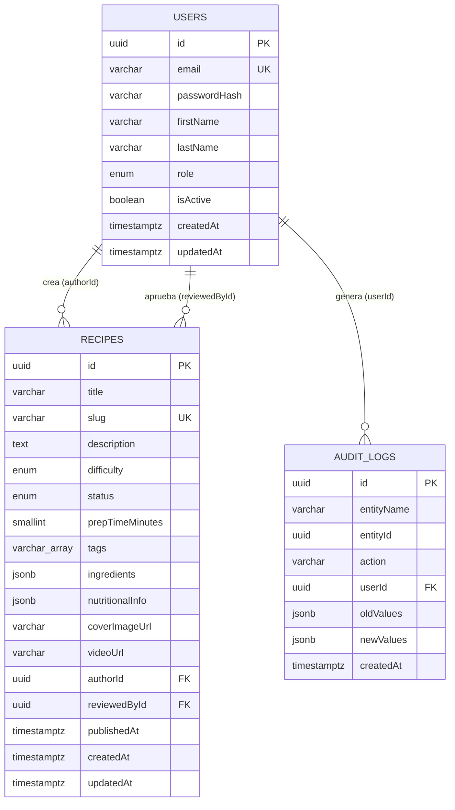

# Modelo de datos

Fuente DDL operativa del esquema: [`prisma/schema.prisma`](../prisma/schema.prisma) (Prisma 7) junto con las migraciones SQL versionadas de Prisma (`20261121201424_init`, `20261123145000_recipes_list_order_indexes` y `20261124160000_recipes_version`). El archivo [`database_schema_init.sql`](../database_schema_init.sql) se conserva como referencia inicial histórica (motor PostgreSQL 15, normalización 3NF con columnas `JSONB` para ingredientes y metadatos nutricionales). Incluye 3 modelos activos (`User`, `Recipe`, `AuditLog`) y usuarios semilla de referencia para los 4 roles RBAC.

## Diagrama ER

## Diccionario de datos

### Enumeraciones (`ENUM`)
- `Role`: `USER`, `CHEF`, `NUTRITIONIST`, `ADMIN`
- `RecipeStatus`: `DRAFT`, `APPROVED`
- `Difficulty`: `EASY`, `MEDIUM`, `HARD`, `EXPERT`

### Tabla `users`
Almacena identidades, credenciales cifradas y roles RBAC.

| Campo | Tipo | Nulo | Descripción |
|---|---|:-:|---|
| `id` | `UUID` | No | Identificador único (`PK`, `gen_random_uuid()`) |
| `email` | `VARCHAR(255)` | No | Correo único de acceso (`UNIQUE`) |
| `passwordHash` | `VARCHAR(255)` | No | Contraseña hasheada con Bcrypt |
| `firstName` | `VARCHAR(100)` | No | Nombre de pila |
| `lastName` | `VARCHAR(100)` | No | Apellido |
| `role` | `Role` | No | Rol RBAC, por defecto `'USER'` |
| `isActive` | `BOOLEAN` | No | Indicador de baja lógica, por defecto `TRUE` |
| `createdAt` | `TIMESTAMPTZ` | No | Fecha de creación (`NOW()`) |
| `updatedAt` | `TIMESTAMPTZ` | No | Última actualización (trigger automático) |

### Tabla `recipes`
Entidad principal con el contenido, metadatos nutricionales y estado de validación profesional.

| Campo | Tipo | Nulo | Descripción |
|---|---|:-:|---|
| `id` | `UUID` | No | Identificador único (`PK`, `gen_random_uuid()`) |
| `title` | `VARCHAR(150)` | No | Título de la receta |
| `slug` | `VARCHAR(200)` | No | Identificador legible autogenerado (`UNIQUE`) |
| `description` | `TEXT` | No | Descripción e instrucciones del plato (10..5000 caracteres en Zod) |
| `difficulty` | `Difficulty` | No | Complejidad, por defecto `'MEDIUM'` |
| `status` | `RecipeStatus` | No | Estado de validación (`DRAFT` o `APPROVED`), por defecto `'DRAFT'` |
| `prepTimeMinutes` | `SMALLINT` | No | Tiempo en minutos (`CHECK ("prepTimeMinutes" > 0 AND "prepTimeMinutes" <= 1440)`) |
| `tags` | `VARCHAR(50)[]` | No | Etiquetas dietarias (máx. 20 ítems de ≤ 50 caracteres en Zod), por defecto `'{}'` |
| `ingredients` | `JSONB` | No | Lista estructurada de ingredientes (`name`, `quantity`, `unit`; 1..100 ítems y `quantity ≤ 100000` en Zod, `quantity > 0` en `RN-07`), con `CHECK (jsonb_typeof("ingredients") = 'array')` |
| `nutritionalInfo` | `JSONB` | Sí | Objeto nutricional opcional tipado (`calories`, `proteinGrams`, `carbsGrams`, `fatGrams`, `fiberGrams` en `[0, 100000]` y `servings` entero `> 0`), con `CHECK ("nutritionalInfo" IS NULL OR jsonb_typeof("nutritionalInfo") = 'object')` |
| `coverImageUrl` | `VARCHAR(512)` | Sí | URL de portada |
| `videoUrl` | `VARCHAR(512)` | Sí | URL de video corto |
| `authorId` | `UUID (FK)` | No | Autor que creó la receta (`-> users.id`) |
| `reviewedById` | `UUID (FK)` | Sí | Profesional que aprobó la receta (`-> users.id`), con `CHECK ("reviewedById" IS NULL OR "reviewedById" <> "authorId")` (`RN-05`) |
| `publishedAt` | `TIMESTAMPTZ` | Sí | Fecha y hora de aprobación |
| `version` | `INTEGER` | No | Versión de contenido para `ETag`/`If-Match` (#46), por defecto `1`; la incrementa `trg_recipes_version` en cada `UPDATE` y no se expone en el JSON |
| `createdAt` | `TIMESTAMPTZ` | No | Fecha de creación (`NOW()`) |
| `updatedAt` | `TIMESTAMPTZ` | No | Última actualización (trigger automático) |

### Tabla `audit_logs`
Registro inmutable de trazabilidad sobre cambios críticos: recetas (`APPROVE`, `RESET_TO_DRAFT`, `DELETE`) y usuarios (`ROLE_CHANGED`, #53; `ACCOUNT_ACTIVATED`/`ACCOUNT_DEACTIVATED`, #56).

| Campo | Tipo | Nulo | Descripción |
|---|---|:-:|---|
| `id` | `UUID` | No | Identificador del evento (`PK`) |
| `entityName` | `VARCHAR(50)` | No | Nombre canónico de la entidad afectada (`'Recipe'` o `'User'`, ADR-0008) |
| `entityId` | `UUID` | No | ID del registro alterado (sin FK hacia `recipes` para conservar trazabilidad tras `DELETE`) |
| `action` | `VARCHAR(50)` | No | Acción ejecutada (`'APPROVE'`, `'RESET_TO_DRAFT'`, `'DELETE'` sobre `Recipe`; `'ROLE_CHANGED'` sobre `User`, con `oldValues`/`newValues = { role }`; `'ACCOUNT_ACTIVATED'`/`'ACCOUNT_DEACTIVATED'` sobre `User`, con `{ isActive }`) |
| `userId` | `UUID (FK)` | Sí | Usuario que ejecutó la acción (`-> users.id`) |
| `oldValues` | `JSONB` | Sí | Snapshot previo al cambio |
| `newValues` | `JSONB` | Sí | Snapshot posterior al cambio |
| `createdAt` | `TIMESTAMPTZ` | No | Marca temporal del evento (`NOW()`) |

### Índices, restricciones CHECK, triggers y datos semilla
- **Extensión y catálogo:** la migración inicial `20261121201424_init` habilita `pgcrypto` (`gen_random_uuid()`) y registra `COMMENT ON COLUMN "audit_logs"."entityId"` documentando la ausencia intencional de FK hacia `recipes` (`RN-06`).
- **Índices B-Tree:** `idx_users_role_isactive`, `idx_recipes_createdat_id` (`"createdAt" DESC, id DESC`), `idx_recipes_authorid_createdat_id` (`"authorId", "createdAt" DESC, id DESC`), `idx_recipes_status_difficulty`, `idx_audit_logs_entity`, `idx_audit_logs_createdat`, `idx_audit_logs_userid`, más los índices únicos implícitos de `UNIQUE(email)` y `UNIQUE(slug)`. Sin índices redundantes sobre `email`/`slug` ni `ON UPDATE CASCADE` (`ADR-0006`). Los dos índices de orden (migración `20261123145000_recipes_list_order_indexes`, #36) resuelven `GET /api/v1/recipes` y `/mine` sin *Sort* de tabla completa; el compuesto por autor reemplazó a `idx_recipes_authorid` y respalda también la FK `fk_recipes_author` (`ON DELETE RESTRICT`). Medición reproducible en [`scripts/perf/explain-recipes-list.sql`](../scripts/perf/explain-recipes-list.sql).
- **Restricciones `CHECK` en `recipes`:**
  - `chk_prep_time_positive`: `CHECK ("prepTimeMinutes" > 0 AND "prepTimeMinutes" <= 1440)` (`RN-07`).
  - `chk_recipes_reviewer_not_author`: `CHECK ("reviewedById" IS NULL OR "reviewedById" <> "authorId")` (`RN-05`).
  - `chk_recipes_ingredients_array`: `CHECK (jsonb_typeof("ingredients") = 'array')`.
  - `chk_recipes_version_positive`: `CHECK ("version" >= 1)` (#46).
  - `chk_recipes_nutritional_info_object`: `CHECK ("nutritionalInfo" IS NULL OR jsonb_typeof("nutritionalInfo") = 'object')` *(en Prisma usar `Prisma.DbNull` para limpiar la columna a SQL `NULL`; `Prisma.JsonNull` escribe JSON `'null'` y es rechazado por el `CHECK`)*.
- **Triggers:** `trg_users_updated_at` y `trg_recipes_updated_at` ejecutan `update_updated_at_column()` en `BEFORE UPDATE` para actualizar `"updatedAt" = NOW()`. `trg_recipes_version` ejecuta `increment_recipe_version()` en `BEFORE UPDATE` (`NEW."version" = OLD."version" + 1`, ignorando cualquier valor enviado; migración `20261124160000_recipes_version`, #46).
- **Seed inicial:** [`prisma/seed.ts`](../prisma/seed.ts) (vía `npx prisma db seed` o `npm run db:seed` con `tsx`) siembra de forma idempotente (`createMany` con `skipDuplicates: true`, `ON CONFLICT DO NOTHING`) los 4 usuarios base RBAC (`user@recetaria.com`, `chef@recetaria.com`, `nutri@recetaria.com`, `admin@recetaria.com`) con `isActive = true`, Bcrypt (`>= 10` rounds, `RN-08`) y guarda *allowlist* en `NODE_ENV=development|test` (bloqueado en producción y otros entornos). [`database_schema_init.sql`](../database_schema_init.sql) conserva los mismos 4 perfiles como referencia histórica.

## Políticas referenciales
| Relación | Restricción (FK) | `ON DELETE` | `ON UPDATE` | Motivo |
|---|---|---|---|---|
| `users → recipes (authorId)` | `fk_recipes_author` | `RESTRICT` | `NO ACTION` | Impide borrar físicamente un usuario si tiene recetas asociadas; obliga a preservar autoría |
| `users → recipes (reviewedById)` | `fk_recipes_reviewer` | `SET NULL` | `NO ACTION` | Preserva la receta si se da de baja el usuario revisor; el historial permanece en `audit_logs` |
| `users → audit_logs (userId)` | `fk_audit_logs_user` | `SET NULL` | `NO ACTION` | Garantiza la inmutabilidad del registro de auditoría aunque se elimine el usuario |
| `audit_logs.entityId` (sin FK a `recipes`) | `N/A` | `N/A` (conservado) | `N/A` | Permite ejecutar borrado físico en `DELETE /api/v1/recipes/:id` manteniendo íntegro el registro histórico del evento `DELETE` |

## Datos sensibles
| Campo | Clasificación | Tratamiento |
|---|---|---|
| `users.email` | Identificación personal | Acceso autenticado; nunca se expone en errores de login ni logs |
| `users.passwordHash` | Credencial crítica | Hash unidireccional Bcrypt (`saltRounds >= 10`); excluido de respuestas JSON |
| `recipes.nutritionalInfo` / `tags` | Salud implícita (Ley 25.326) | Validación estricta con Zod; aprobación restringida a perfiles `CHEF` / `NUTRITIONIST` |
