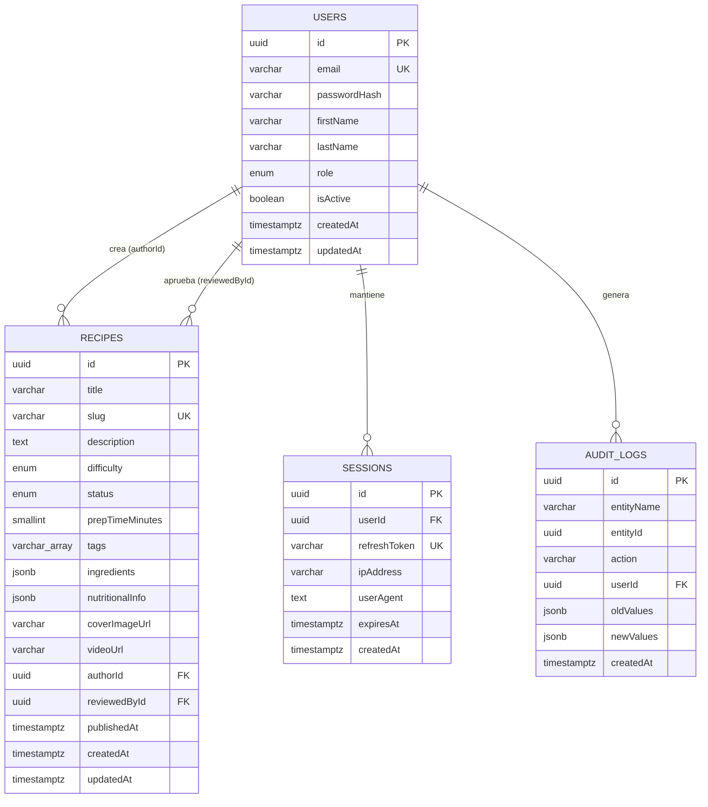

# Modelo de datos

Fuente de verdad del esquema SQL inicial: [`database_schema_init.sql`](../database_schema_init.sql) (motor PostgreSQL 15, normalización 3NF con columnas `JSONB` para ingredientes y metadatos nutricionales).

## Diagrama ER

## Diccionario de datos

### Enumeraciones (`ENUM`)
- `Role`: `USER`, `CHEF`, `NUTRITIONIST`, `ADMIN`
- `RecipeStatus`: `DRAFT`, `PENDING_REVIEW`, `APPROVED`, `REJECTED`, `ARCHIVED`
- `Difficulty`: `EASY`, `MEDIUM`, `HARD`, `EXPERT`

### Tabla `users`
Almacena identidades, credenciales cifradas y roles RBAC.

| Campo | Tipo | Nulo | Descripción |
|---|---|:-:|---|
| `id` | `UUID` | No | Identificador único (`PK`, `gen_random_uuid()`) |
| `email` | `VARCHAR(255)` | No | Correo único de acceso (`UNIQUE`) |
| `passwordHash` | `VARCHAR(255)` | No | Contraseña hasheada con Bcrypt |
| `firstName` | `VARCHAR(100)` | No | Nombre de pila |
| `lastName` | `VARCHAR(100)` | No | Apellido |
| `role` | `Role` | No | Rol RBAC, por defecto `'USER'` |
| `isActive` | `BOOLEAN` | No | Indicador de baja lógica, por defecto `TRUE` |
| `createdAt` | `TIMESTAMPTZ` | No | Fecha de creación (`NOW()`) |
| `updatedAt` | `TIMESTAMPTZ` | No | Última actualización (trigger automático) |

### Tabla `recipes`
Entidad principal con el contenido, metadatos nutricionales y estado de validación profesional.

| Campo | Tipo | Nulo | Descripción |
|---|---|:-:|---|
| `id` | `UUID` | No | Identificador único (`PK`, `gen_random_uuid()`) |
| `title` | `VARCHAR(150)` | No | Título de la receta |
| `slug` | `VARCHAR(200)` | No | Identificador legible para URLs (`UNIQUE`) |
| `description` | `TEXT` | No | Descripción e instrucciones del plato |
| `difficulty` | `Difficulty` | No | Complejidad, por defecto `'MEDIUM'` |
| `status` | `RecipeStatus` | No | Estado de revisión, por defecto `'DRAFT'` |
| `prepTimeMinutes` | `SMALLINT` | No | Tiempo en minutos (`CHECK ("prepTimeMinutes" > 0)`) |
| `tags` | `VARCHAR(50)[]` | No | Etiquetas dietarias, por defecto `'{}'` |
| `ingredients` | `JSONB` | No | Lista estructurada de ingredientes y cantidades |
| `nutritionalInfo` | `JSONB` | Sí | Información nutricional validada |
| `coverImageUrl` | `VARCHAR(512)` | Sí | URL de portada |
| `videoUrl` | `VARCHAR(512)` | Sí | URL de video corto |
| `authorId` | `UUID (FK)` | No | Autor que creó la receta (`-> users.id`) |
| `reviewedById` | `UUID (FK)` | Sí | Profesional que aprobó/revisó (`-> users.id`) |
| `publishedAt` | `TIMESTAMPTZ` | Sí | Fecha y hora de publicación/aprobación |
| `createdAt` | `TIMESTAMPTZ` | No | Fecha de creación (`NOW()`) |
| `updatedAt` | `TIMESTAMPTZ` | No | Última actualización (trigger automático) |

### Tabla `sessions`
Registra refresh tokens y huella de sesiones activas.

| Campo | Tipo | Nulo | Descripción |
|---|---|:-:|---|
| `id` | `UUID` | No | Identificador de sesión (`PK`) |
| `userId` | `UUID (FK)` | No | Usuario dueño de la sesión (`-> users.id`) |
| `refreshToken` | `VARCHAR(512)` | No | Token único de refresco (`UNIQUE`) |
| `ipAddress` | `VARCHAR(45)` | Sí | Dirección IP de origen (IPv4/IPv6) |
| `userAgent` | `TEXT` | Sí | Agente cliente del dispositivo |
| `expiresAt` | `TIMESTAMPTZ` | No | Expiración del token |
| `createdAt` | `TIMESTAMPTZ` | No | Fecha de emisión (`NOW()`) |

### Tabla `audit_logs`
Registro inmutable de trazabilidad sobre cambios de estado críticos (RN-06).

| Campo | Tipo | Nulo | Descripción |
|---|---|:-:|---|
| `id` | `UUID` | No | Identificador del evento (`PK`) |
| `entityName` | `VARCHAR(50)` | No | Nombre de la entidad afectada (ej. `'Recipe'`) |
| `entityId` | `UUID` | No | ID del registro alterado |
| `action` | `VARCHAR(50)` | No | Acción ejecutada (ej. `'APPROVE'`, `'REJECT'`) |
| `userId` | `UUID (FK)` | Sí | Usuario que ejecutó la acción (`-> users.id`) |
| `oldValues` | `JSONB` | Sí | Snapshot previo al cambio |
| `newValues` | `JSONB` | Sí | Snapshot posterior al cambio |
| `createdAt` | `TIMESTAMPTZ` | No | Marca temporal del evento (`NOW()`) |

### Índices y triggers
- **Índices B-Tree:** `idx_users_email`, `idx_users_role_isactive`, `idx_recipes_authorid`, `idx_recipes_status_difficulty`, `idx_recipes_slug`, `idx_sessions_userid`, `idx_audit_logs_entity`, `idx_audit_logs_createdat`.
- **Triggers:** `trg_users_updated_at` y `trg_recipes_updated_at` ejecutan `update_updated_at_column()` en `BEFORE UPDATE` para actualizar `"updatedAt" = NOW()`.

## Políticas referenciales
| Relación | Al borrar el padre | Motivo |
|---|---|---|
| `users → recipes (authorId)` | `RESTRICT` | Impide borrar un usuario si tiene recetas asociadas; obliga a usar baja lógica (`isActive = false`) |
| `users → recipes (reviewedById)` | `SET NULL` | Preserva la receta si se da de baja el usuario revisor; el historial sigue en `audit_logs` |
| `users → audit_logs (userId)` | `SET NULL` | Garantiza la inmutabilidad y trazabilidad histórica del log aunque se elimine el usuario |
| `users → sessions (userId)` | `CASCADE` | **Justificación:** las sesiones y refresh tokens carecen de valor sin el usuario y deben revocarse de inmediato al eliminar la cuenta |

## Datos sensibles
| Campo | Clasificación | Tratamiento |
|---|---|---|
| `users.email` | Identificación personal | Acceso autenticado; nunca se expone en errores de login ni logs |
| `users.passwordHash` | Credencial crítica | Hash unidireccional Bcrypt (`saltRounds >= 10`); excluido de respuestas JSON |
| `sessions.ipAddress` / `userAgent` | Telemetría personal | Uso exclusivo para seguridad y detección de sesiones; alcance detallado en [`compliance.md`](compliance.md) |
| `recipes.nutritionalInfo` / `tags` | Salud implícita (Ley 25.326) | Validación estricta con Zod; aprobación restringida a perfiles `CHEF` / `NUTRITIONIST` |
