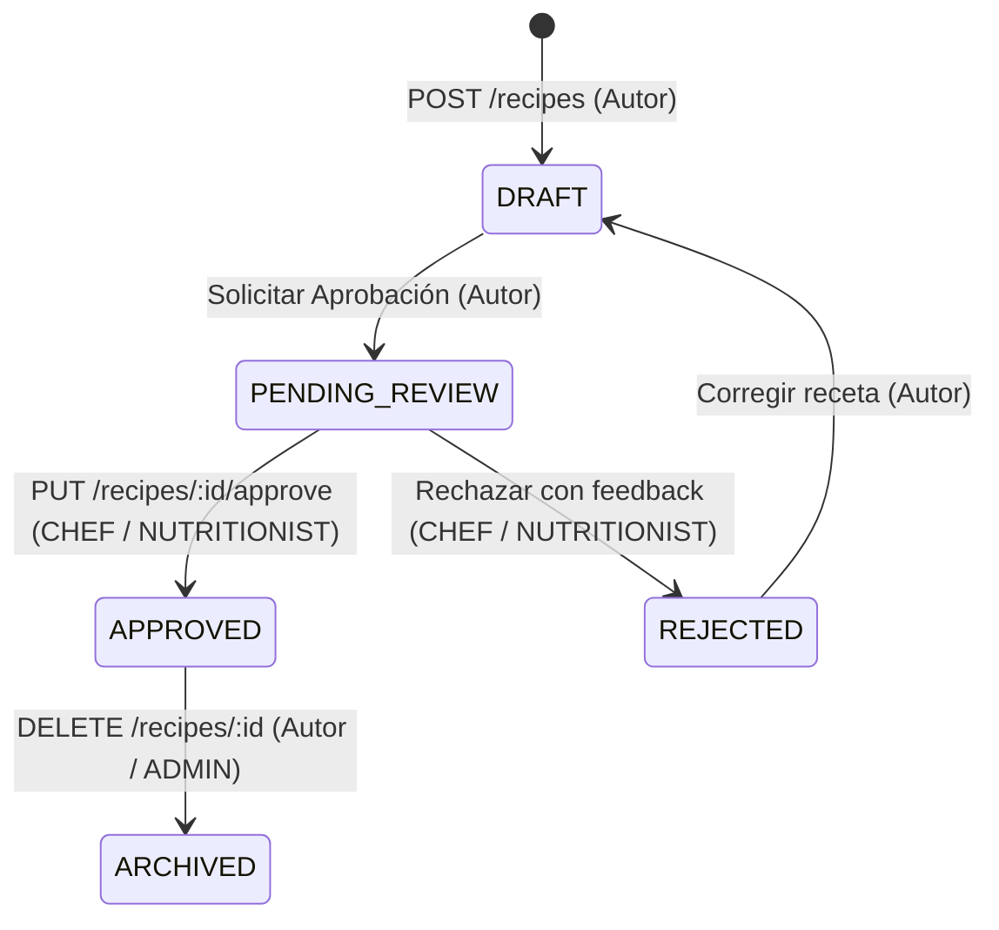

# Reglas de Negocio: Ciclo de Vida y Validación de Recetas

| Metadata | Valor |
| :--- | :--- |
| **Identificador** | `RULE-REC-001` |
| **Módulo** | Recipes (`src/modules/recipes`) |
| **Estándar** | SKL-PRO-001 (Nivel 3: Especificación en `/doc/rules/`) |
| **Versión** | 1.0.0 |

---

## 1. Máquina de Estados de la Receta

El campo `status` de la tabla `recipes` es un tipo ENUM con transiciones controladas:

---

## 2. Invariantes de Negocio

### 2.1. Creación de Receta
- **Estado Inicial:** Toda nueva receta creada mediante `POST /api/v1/recipes` nace obligatoriamente en estado `DRAFT`.
- **Autoría:** El campo `authorId` se extrae del token decodificado (`req.user.id`). No se permite crear recetas a nombre de terceros.
- **Tiempos y Validación:** `prepTimeMinutes` debe ser un entero estrictamente mayor a 0 (`CHECK ("prepTimeMinutes" > 0)`).
- **Ingredientes:** El campo `ingredients` debe contener un array JSONB con al menos un ingrediente estructurado con nombre y cantidad.

### 2.2. Modificación y Borrado (Ownership)
- **Modificación (`PUT /recipes/:id`):** Solo el usuario que figura en `authorId` puede actualizar los datos de la receta.
- **Borrado (`DELETE /recipes/:id`):** Permitido únicamente al autor original de la receta o a un usuario con rol `ADMIN`.
- **Integridad:** Las recetas no se eliminan físicamente si tienen referencias activas que violen restricciones de base de datos (`ON DELETE RESTRICT`).

### 2.3. Aprobación Profesional (`PUT /recipes/:id/approve`)
- **Permisos RBAC:** Exclusivo para usuarios autenticados cuyo rol sea `CHEF` o `NUTRITIONIST`. Si un usuario con rol `USER` invoca este endpoint, el sistema debe retornar `403 Forbidden`.
- **Transaccionalidad Atómica:** El cambio de estado a `APPROVED` debe ejecutarse dentro de un bloque `prisma.$transaction` que incluya:
  1. Actualización de `recipes.status = 'APPROVED'`.
  2. Asignación de `recipes.reviewedById = req.user.id`.
  3. Creación de un registro en `audit_logs` con `action = 'APPROVE'`, `entityName = 'Recipe'`, `entityId = recipe.id` y `userId = req.user.id`.
