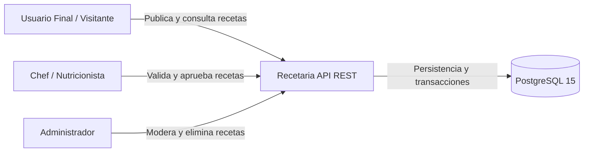
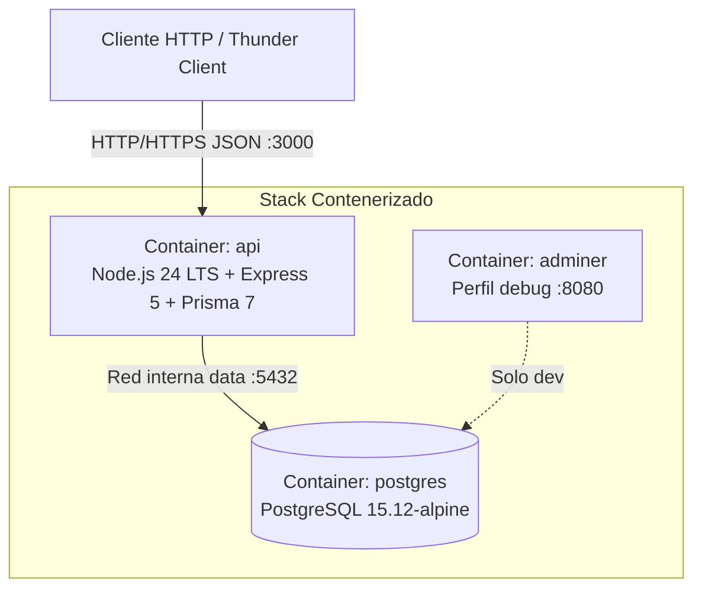

# Arquitectura — Recetaria API

## 1. Objetivos de calidad
Los 3 atributos que más importan en el MVP, en orden de prioridad:
1. **Seguridad e integridad clínica:** control estricto de roles (RBAC), contraseñas con Bcrypt, autenticación JWT stateless, validación previa con Zod y trazabilidad transaccional en `audit_logs` (RNF-02, RNF-03).
2. **Mantenibilidad:** separación estricta en 4 capas desacopladas por módulo (`Router -> Controller -> Service -> Repository`) y TypeScript estricto sin `any` (RNF-04).
3. **Rendimiento:** respuestas rápidas (< 150 ms P95) en consultas de lectura mediante índices B-Tree compuestos en PostgreSQL (RNF-01).

## 2. Restricciones
- **Plazo académico:** entrega del MVP funcional en 2 semanas enfocado en `Auth` y `Recipes`.
- **Stack definido (`ADR-0006`):** Node.js 24 LTS, ESM nativo (`nodenext`), Express 5, TypeScript 7 estricto (`tsx` en dev), PostgreSQL 15, Prisma 7 GA (`@prisma/adapter-pg`), Zod 4 (`z.strictObject`), Bcrypt y JWT.
- **Entorno reproducible:** ejecución local e imagen productiva endurecida mediante Docker y Docker Compose v2 (`Dockerfile`, `compose.yaml`, `compose.override.yaml`).

## 3. Contexto (C4 nivel 1)

## 4. Estrategia de solución
- **Monolito modular en 4 capas:** organizado por módulo funcional (`src/modules/auth/`, `src/modules/recipes/`), con `src/app.ts` (construcción Express sin `listen()`, testeable con Supertest) separado de `src/server.ts` (`dist/server.js`, arranque HTTP y apagado ordenado ante `SIGTERM`/`SIGINT`), precedido por el middleware global `loggerMiddleware`.
  1. **Router (`*.router.ts`) y Middlewares (`src/middlewares/`):** mapean rutas `/api/v1/...` y ejecutan en rutas protegidas la secuencia **`authMiddleware` (JWT) -> `rbacMiddleware` (Roles) -> `validateMiddleware` (Zod 4 `z.strictObject`)** (rechaza `401`/`403` antes de parsear payloads). En rutas públicas corre solo `validateMiddleware`.
  2. **Controller (`*.controller.ts`):** extrae datos validados (`req.valid` / `req.user`), envuelve cada método en `try/catch` y emite respuestas JSON bajo el contrato JSend extendido.
  3. **Service (`*.service.ts`):** concentra el 100 % de las reglas de negocio (`RN-01` a `RN-08`), generación de `slug` y coordinación de transacciones atómicas. **Nunca** instancia ni llama a Prisma directamente.
  4. **Repository (`*.repository.ts`):** única capa que accede a Prisma Client / PostgreSQL.
- **Autenticación 100 % stateless:** sesiones vía Bearer JWT sin tabla `sessions` en base de datos.

## 5. Contenedores (C4 nivel 2)

| Contenedor | Tecnología | Responsabilidad |
|---|---|---|
| **API** | Node.js 24 LTS (ESM) + Express 5 + TypeScript 7 | Logging HTTP, `/health` + `/health/ready`, enrutamiento `/api/v1`, JWT/RBAC, validación Zod 4, reglas de negocio y acceso vía Prisma 7 |
| **Base de datos** | PostgreSQL 15.12-alpine | Persistencia relacional ACID (`users`, `recipes`, `audit_logs`), columnas `JSONB`, índices B-Tree y triggers `updatedAt` |
| **Adminer** *(opcional)* | Adminer 4.8.1 (perfil `debug`) | Visor SQL local en `127.0.0.1:8080` para inspección durante desarrollo |

## 6. Conceptos transversales
- **Observabilidad y salud (`GET /health`, `GET /health/ready` y `loggerMiddleware`):**
  - `GET /health` (liveness): liviano, **sin consultar PostgreSQL**, responde `200 OK` inmediatamente (usado por el `HEALTHCHECK` exec del `Dockerfile` para evitar reinicios en cascada).
  - `GET /health/ready` (readiness): verifica conectividad con PostgreSQL (`SELECT 1`), devolviendo `200 OK` o `503 Service Unavailable`.
  - `loggerMiddleware` imprime en `stdout` cada petición con formato `[ISO_DATE] METHOD /url` sin registrar headers sensibles ni contraseñas.
- **Autenticación y autorización:** Bearer JWT en header `Authorization` con payload `{ id, role }` (`algorithms: ["HS256"]`), más `rbacMiddleware([roles])` para rutas restringidas.
- **Contrato de respuesta universal (JSend extendido):**
  - Éxito (`200`, `201`): `{ "success": true, "statusCode": 200, "message": "...", "data": { ... } }`
  - Error (`400`, `401`, `403`, `404`, `409`, `500`, `503`): `{ "success": false, "statusCode": 400, "message": "...", "errors": [{ "field": "...", "message": "..." }] }`
- **Catálogo de endpoints base:**
  - `GET /health` (Público, liveness sin DB) y `GET /health/ready` (Público, readiness con `SELECT 1`)
  - `POST /api/v1/auth/register` (Público, acepta `role` opcional en MVP) y `POST /api/v1/auth/login` (Público, rechaza `isActive === false` con `401`)
  - `GET /api/v1/recipes` (Público, devuelve `data: { items, meta }` ordenado por `createdAt DESC, id DESC`, filtros `?status=&difficulty=&authorId=` y paginación `?page=1&limit=20` máx `100`), `GET /api/v1/recipes/mine` (Autenticado, devuelve solo las recetas de `req.user.id`, registrada antes de `/:id`), `GET /api/v1/recipes/:id` (Público, UUIDv4)
  - `POST /api/v1/recipes` (Autenticado, inicia en `DRAFT` con `slug` `<titulo>-<8-hex>`)
  - `PUT /api/v1/recipes/:id` (Autor, payload parcial o total; reinicia a `DRAFT` con auditoría solo si estaba `APPROVED`)
  - `DELETE /api/v1/recipes/:id` (Autor o `ADMIN`, borrado físico con registro en `audit_logs`)
  - `PUT /api/v1/recipes/:id/approve` (`CHEF`, `NUTRITIONIST` distinto del autor; pasa `DRAFT -> APPROVED` con auditoría)
- **Manejo de errores:** errores de Zod o de dominio de entrada retornan `400`; token faltante/inválido o login fallido `401`; rol insuficiente, ownership inválido o auto-aprobación `403`; recurso inexistente (`P2025`) `404`; conflicto de unicidad (`P2002`) o receta ya aprobada `409`; base no disponible `503`; fallos inesperados `500` sin exponer *stack trace* en producción.
- **Transacciones ACID:** las operaciones `APPROVE`, `RESET_TO_DRAFT` y `DELETE` ejecutan su mutación en `recipes` y la inserción en `audit_logs` (`entityName = "Recipe"`) dentro de `prisma.$transaction`.

## 7. Riesgos, deuda técnica y paso a Fase Beta / Producción
- **Código fuente y colección Thunder Client pendientes de implementación en `src/` y `docs/thunder-client-collection.json`:** se implementarán por fases tras cerrar la Fase 2 de configuración técnica.
- **Checklist diferido a Fase Beta / Producción (`ADR-0006`):** migración de secretos `.env` a archivos `secrets:`/`*_FILE`, fijado por digest `@sha256:...` en imágenes base, separación de roles PostgreSQL (`recetaria_runtime` vs `recetaria_migrator`), restricción de `role` en `/register` vía KYC y subida directa a S3 (ver [roadmap.md](roadmap.md)).
- **Filtros avanzados sobre JSONB:** las búsquedas iniciales indexan solo columnas escalares (`status`, `difficulty`, `authorId`).

Decisiones de arquitectura: ver [docs/adr/](adr/)
