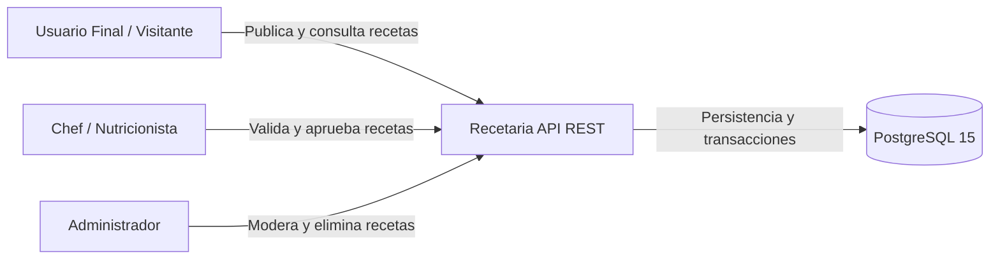
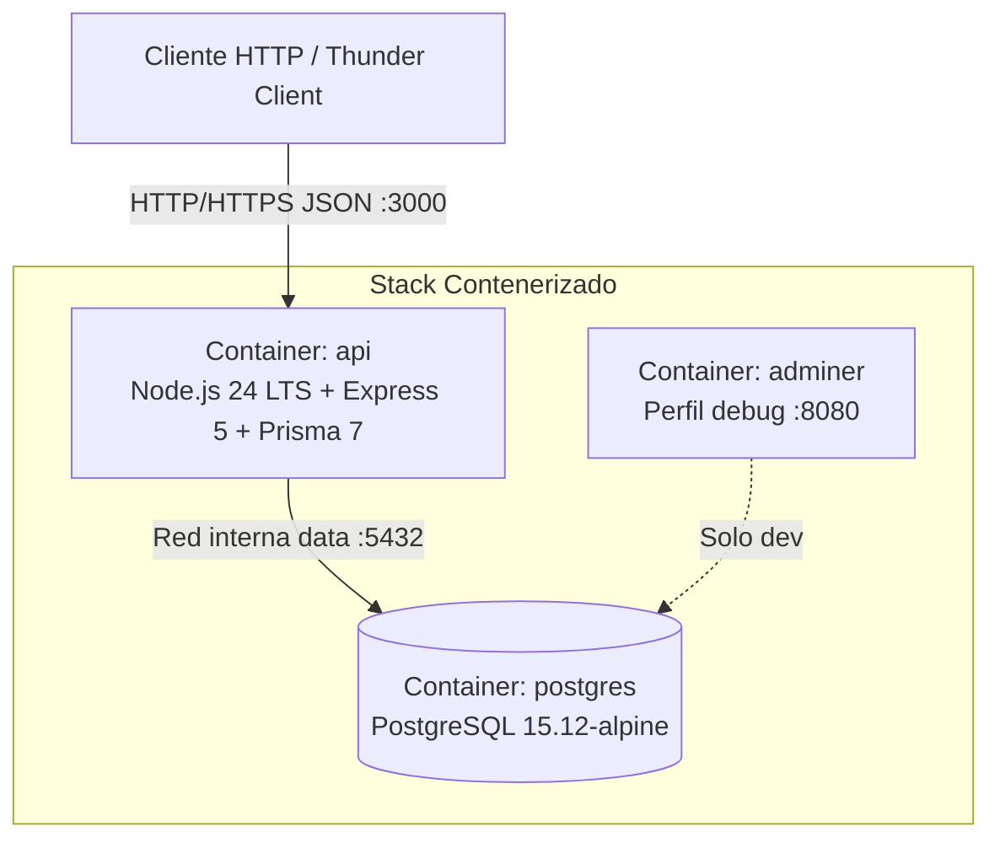

# Arquitectura — Recetaria API

## 1. Objetivos de calidad
Los 3 atributos que más importan en el MVP, en orden de prioridad:
1. **Seguridad e integridad clínica:** control estricto de roles (RBAC), contraseñas con Bcrypt, autenticación JWT stateless, validación previa con Zod y trazabilidad transaccional en `audit_logs` (RNF-02, RNF-03).
2. **Mantenibilidad:** separación estricta en 4 capas desacopladas por módulo (`Router -> Controller -> Service -> Repository`) y TypeScript estricto sin `any` (RNF-04).
3. **Rendimiento:** respuestas rápidas (< 150 ms P95) en consultas de lectura mediante índices B-Tree compuestos en PostgreSQL (RNF-01).

## 2. Restricciones
- **Plazo académico:** entrega del MVP funcional en 2 semanas enfocado en `Auth` y `Recipes`.
- **Stack definido (`ADR-0006`):** Node.js 24 LTS, ESM nativo (`nodenext`), Express 5, TypeScript 7 estricto (`tsx` en dev), PostgreSQL 15, Prisma 7 GA (`@prisma/adapter-pg`), Zod 4 (`z.strictObject`), Bcrypt y JWT.
- **Entorno reproducible:** ejecución local e imagen productiva endurecida mediante Docker y Docker Compose v2 (`Dockerfile`, `compose.yaml`, `compose.override.yaml`).

## 3. Contexto (C4 nivel 1)

## 4. Estrategia de solución
- **Monolito modular en 4 capas:** organizado por módulo funcional (`src/modules/auth/`, `src/modules/recipes/`), con `src/app.ts` (construcción Express sin `listen()`, testeable con Supertest) separado de `src/server.ts` (`dist/server.js`, arranque HTTP y apagado ordenado ante `SIGTERM`/`SIGINT`), precedido por el middleware global `loggerMiddleware`.
  1. **Router (`*.router.ts`) y Middlewares (`src/middlewares/`):** mapean rutas `/api/v1/...` y ejecutan en rutas protegidas la secuencia **`authMiddleware` (JWT) -> `rbacMiddleware` (Roles) -> `validateMiddleware` (Zod 4 `z.strictObject`)** (rechaza `401`/`403` antes de parsear payloads). En rutas públicas corre solo `validateMiddleware`.
  2. **Controller (`*.controller.ts`):** extrae datos validados (`req.valid` / `req.user`), envuelve cada método en `try/catch` y emite respuestas JSON bajo el contrato JSend extendido.
  3. **Service (`*.service.ts`):** concentra el 100 % de las reglas de negocio (`RN-01` a `RN-08`), generación de `slug` y coordinación de transacciones atómicas. **Nunca** instancia ni llama a Prisma directamente.
  4. **Repository (`*.repository.ts`):** única capa que accede a Prisma Client / PostgreSQL.
- **Autenticación 100 % stateless:** sesiones vía Bearer JWT sin tabla `sessions` en base de datos.

## 5. Contenedores (C4 nivel 2)

| Contenedor | Tecnología | Responsabilidad |
|---|---|---|
| **API** | Node.js 24 LTS (ESM) + Express 5 + TypeScript 7 | Logging HTTP, `/health` + `/health/ready`, enrutamiento `/api/v1`, JWT/RBAC, validación Zod 4, reglas de negocio y acceso vía Prisma 7 |
| **Base de datos** | PostgreSQL 15.12-alpine | Persistencia relacional ACID (`users`, `recipes`, `audit_logs`), columnas `JSONB`, índices B-Tree y triggers `updatedAt` |
| **Adminer** *(opcional)* | Adminer 4.8.1 (perfil `debug`) | Visor SQL local en `127.0.0.1:8080` para inspección durante desarrollo |

## 6. Conceptos transversales
- **Observabilidad y salud (`GET /health`, `GET /health/ready` y `loggerMiddleware`):**
  - `GET /health` (liveness): liviano, **sin consultar PostgreSQL**, responde `200 OK` inmediatamente (usado por el `HEALTHCHECK` exec del `Dockerfile` para evitar reinicios en cascada).
  - `GET /health/ready` (readiness): verifica conectividad con PostgreSQL (`SELECT 1`), devolviendo `200 OK` o `503 Service Unavailable`.
  - `loggerMiddleware` imprime en `stdout` cada petición con formato `[ISO_DATE] METHOD /url` sin registrar headers sensibles ni contraseñas.
- **Protección de recursos en lecturas públicas (OWASP API4, #36, #18):** `GET /api/v1/recipes` y `GET /api/v1/recipes/:id` aplican (cuota compartida) `createRateLimitMiddleware` (`express-rate-limit`, ventana fija de 120 solicitudes/minuto por IP, IPv6 agrupado por `/56`) **antes** de `validateMiddleware`, con headers draft-8 `RateLimit`/`RateLimit-Policy` y `Retry-After` expuestos por CORS y `429 Too Many Requests` en JSend. El orden `("createdAt" DESC, id DESC)` del catálogo y de `/mine` se resuelve con `idx_recipes_createdat_id` e `idx_recipes_authorid_createdat_id` sin *Sort* de tabla completa (medición en `scripts/perf/explain-recipes-list.sql`).
- **Autenticación y autorización:** Bearer JWT en header `Authorization` con payload `{ id, role }` (`algorithms: ["HS256"]`), más `rbacMiddleware([roles])` para rutas restringidas.
- **Protección contra fuerza bruta en `/api/v1/auth` (OWASP API2/API4, #39):** `POST /login` encadena dos limitadores antes de `validateMiddleware` —por IP (10 intentos fallidos / 15 min) y por cuenta (20 fallidos / 15 min, clave `sha256` del email normalizado para no guardar emails en claro)— contando solo respuestas `>= 400`; `POST /register` limita 5 solicitudes por hora por IP. El `429` usa un mensaje genérico idéntico exista o no la cuenta (`RN-08`) y corta antes del repositorio y de Bcrypt. El limitador por cuenta **no emite headers** (no revela a terceros cuántos fallos tuvo un email ni cuándo se bloqueará) y sus `429` **no consumen la cuota por IP** (reintentar contra una cuenta bloqueada no bloquea la IP ni a otros usuarios detrás del mismo NAT). **Trade-off asumido (bloqueo dirigido):** como cada IP aporta hasta 10 fallos, bastan **3 orígenes** (3 IPs o 3 subredes IPv6 `/56`; una asignación doméstica `/48` trae 256) para bloquear una cuenta ajena durante 15 minutos, y repetirlo cada ventana con ~21 solicitudes la mantiene bloqueada. Mitigaciones previstas fuera del MVP: alertar cuando se dispara `auth-login-account`, permitir a la IP que ya inició sesión con éxito en esa cuenta o reemplazar el corte por retardo progresivo. El límite de registro (5/h por IP) puede afectar a usuarios legítimos detrás de un NAT compartido.
- **Contrato de respuesta universal (JSend extendido):**
  - Éxito (`200`, `201`): `{ "success": true, "statusCode": 200, "message": "...", "data": { ... } }`
  - Error (`400`, `401`, `403`, `404`, `409`, `412`, `428`, `429`, `500`, `503`): `{ "success": false, "statusCode": 400, "message": "...", "errors": [{ "field": "...", "message": "..." }] }`
- **Catálogo de endpoints base:**
  - `GET /health` (Público, liveness sin DB) y `GET /health/ready` (Público, readiness con `SELECT 1`)
  - `POST /api/v1/auth/register` (Público, acepta `role` opcional en MVP) y `POST /api/v1/auth/login` (Público, rechaza `isActive === false` con `401`)
  - `GET /api/v1/recipes` (Público, devuelve `data: { items, meta }` ordenado por `createdAt DESC, id DESC`, filtros `?status=&difficulty=&authorId=` y paginación `?page=1&limit=20` con `limit` máx `100` y ventana `page × limit` ≤ `10000`; rate limit de 120 req/min por IP con `429` JSend, índice `idx_recipes_createdat_id`), `GET /api/v1/recipes/mine` (Autenticado, devuelve solo las recetas de `req.user.id` con filtros `?status=&difficulty=` y la misma paginación; `authorId` → `400`; registrada antes de `/:id`, sin rate limit), `GET /api/v1/recipes/:id` (Público, UUIDv4 → `400`, inexistente → `404`, mismo rate limit del catálogo)
  - `POST /api/v1/recipes` (Autenticado, inicia en `DRAFT` con `slug` `<titulo>-<8-hex>`)
  - `PUT /api/v1/recipes/:id` (Autor, payload parcial o total; reinicia a `DRAFT` con auditoría solo si estaba `APPROVED`)
  - `DELETE /api/v1/recipes/:id` (Autor o `ADMIN`, borrado físico con registro en `audit_logs`)
  - `PUT /api/v1/recipes/:id/approve` (`CHEF`, `NUTRITIONIST` distinto del autor; exige `If-Match` con el `ETag` de la versión revisada, `428` si falta y `412` si cambió; pasa `DRAFT -> APPROVED` con auditoría)
- **Solicitudes condicionales (#46):**
  - `GET /api/v1/recipes/:id`, `PUT /:id` y `PUT /:id/approve` devuelven un `ETag` fuerte (`"<version>"`) con la columna `recipes.version`, que incrementa el trigger `trg_recipes_version` en cada `UPDATE`.
  - Se descartó `updatedAt` porque `NOW()` toma el inicio de la transacción y no es monotónico.
  - `If-None-Match` con el `ETag` vigente → `304`.
  - CORS permite `If-Match` y expone `ETag`.
  - El resto de las respuestas conserva el `ETag` débil automático de Express.
- **Manejo de errores:** errores de Zod o de dominio de entrada retornan `400`; token faltante/inválido o login fallido `401`; rol insuficiente, ownership inválido o auto-aprobación `403`; recurso inexistente (`P2025`) `404`; conflicto de unicidad (`P2002`) o receta ya aprobada `409`; `If-Match` con una versión obsoleta `412`; `If-Match` ausente o `*` en una operación condicional `428`; base no disponible `503`; fallos inesperados `500` sin exponer *stack trace* en producción.
- **Transacciones ACID:** las operaciones `APPROVE`, `RESET_TO_DRAFT` y `DELETE` ejecutan su mutación en `recipes` y la inserción en `audit_logs` (`entityName = "Recipe"`) dentro de `prisma.$transaction`.

## 7. Riesgos, deuda técnica y paso a Fase Beta / Producción
- **Código fuente y colección Thunder Client pendientes de implementación en `src/` y `docs/thunder-client-collection.json`:** se implementarán por fases tras cerrar la Fase 2 de configuración técnica.
- **Checklist diferido a Fase Beta / Producción (`ADR-0006`):** migración de secretos `.env` a archivos `secrets:`/`*_FILE`, fijado por digest `@sha256:...` en imágenes base, separación de roles PostgreSQL (`recetaria_runtime` vs `recetaria_migrator`), restricción de `role` en `/register` vía KYC y subida directa a S3 (ver [roadmap.md](roadmap.md)).
- **Índices en tablas con datos (#36):** la migración `20261123145000_recipes_list_order_indexes` usa `CREATE INDEX` simple (bloquea escrituras en `recipes` mientras se construye; aceptable en el MVP). En Fase Beta / Producción, toda creación de índices sobre tablas con tráfico debe usar `CREATE INDEX CONCURRENTLY` en una migración sin transacción.
- **Rate limit en memoria y `trust proxy` (#36, #38):** el store de `express-rate-limit` es por proceso (válido para **una réplica**); con varias réplicas se requiere store compartido (p. ej. `rate-limit-redis`). La IP del cliente se resuelve con la variable validada `TRUST_PROXY` (`src/config/env.ts` → `buildApp({ trustProxy })`): `0` por defecto (ignora `X-Forwarded-For`), número exacto de saltos (`1`–`10`) o lista de IPs/CIDR/presets de los proxies reales (preferentemente la IP exacta del proxy); se rechazan al arrancar `true`, `false` y rangos más amplios que `/8` (IPv4) o `/16` (IPv6), incluidos los IPv4 mapeados (`::ffff:0:0/96`), que permitirían falsificar la IP y evadir el límite. Configurar más saltos que proxies reales también permite falsificarla. **Al desplegar detrás de un proxy inverso es obligatorio configurarla** (si no, todos los clientes comparten la cuota del proxy). Los límites de `/auth` (#39) dependen de la misma configuración.
- **`GET /api/v1/recipes/mine` sin rate limit (#18, riesgo asumido):** la ruta exige JWT y queda acotada por `limit` ≤ `100`, la ventana `page × limit` ≤ `10000` y el índice `idx_recipes_authorid_createdat_id`, pero un usuario autenticado puede repetir `count` + `findMany` sin cuota. Mitigación prevista: limitador por `req.user.id` colocado después de `authGuard`.
- **Detalle público de `DRAFT` con datos de salud implícita:** `GET /api/v1/recipes/:id` expone a Visitantes `tags` y `nutritionalInfo` de recetas no aprobadas (decisión de producto según `docs/roles.md`; ver la clasificación Ley 25.326 en `docs/data_model.md`).
- **Revisor o `ADMIN` desactivado o degradado con JWT vigente (#19, #21, riesgo asumido):** como `authMiddleware` es 100 % stateless (`RN-08`), un `CHEF`/`NUTRITIONIST` puede seguir aprobando, y un `ADMIN` borrando recetas ajenas, con `isActive = false` o con el rol cambiado, hasta que expire su token (`JWT_EXPIRES_IN`). Si fue borrado de `users`, la FK hace fallar la transacción (`P2003` → `401`). Mitigación prevista fuera del MVP: verificar `isActive`/`role` en la base para acciones privilegiadas o usar tokens de vida corta con refresh.
- ~~**Aprobación sin versión del contenido revisado (#20)**~~ — **resuelto en #46**: la aprobación exige `If-Match` con la versión revisada, verificada sobre la fila bloqueada (`412` si cambió). Pendiente opcional: exigir `If-Match` también en `PUT /:id`, para evitar *lost updates* entre ediciones del mismo Autor.
- **`PUT /api/v1/recipes/:id` sin rate limit (#20, riesgo asumido):** la ruta es autenticada y está acotada por el límite de `100kb`, `tags` ≤ 20 e `ingredients` ≤ 100, pero cada edición corre una transacción con `FOR UPDATE`. La mitigación prevista es la misma que en `/mine`: un limitador por `req.user.id`.
- **Auto-registro como `ADMIN` + borrado físico (#21, bloqueante para Beta):** `POST /api/v1/auth/register` acepta `role` para la evaluación del MVP (PRD §9). Con `DELETE /api/v1/recipes/:id`, cualquiera que se registre como `ADMIN` puede borrar de forma irreversible todo el catálogo. Lo único que queda es el snapshot mínimo de `audit_logs`. Antes de Beta es obligatorio restringir `role` en `/register` (KYC o asignación por un administrador).
- **Inmutabilidad de `audit_logs` solo a nivel aplicación:** ningún trigger ni `REVOKE` impide un `UPDATE`/`DELETE` directo sobre la tabla, así que el no repudio depende del código. Se resuelve con la separación de roles de PostgreSQL prevista (`recetaria_runtime` solo con `INSERT`/`SELECT` sobre `audit_logs`).
- **Filtros avanzados sobre JSONB:** las búsquedas iniciales indexan solo columnas escalares (`status`, `difficulty`, `authorId`).

Decisiones de arquitectura: ver [docs/adr/](adr/)
