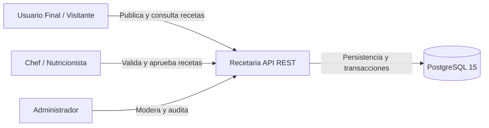
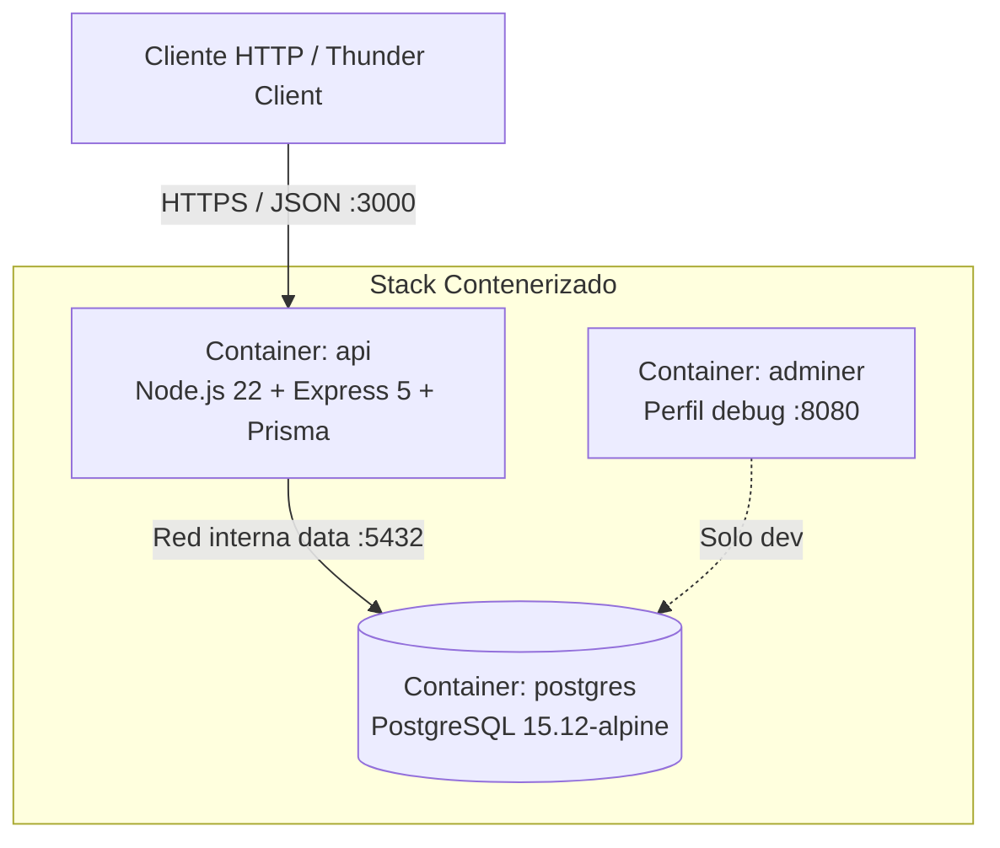

# Arquitectura — Recetaria API

## 1. Objetivos de calidad
Los 3 atributos que más importan en el MVP, en orden de prioridad:
1. **Seguridad e integridad clínica:** control estricto de roles (RBAC), contraseñas con Bcrypt, autenticación JWT stateless, validación previa con Zod y trazabilidad transaccional en `audit_logs` (RNF-02, RNF-03).
2. **Mantenibilidad:** separación estricta en 4 capas desacopladas por módulo (`Router -> Controller -> Service -> Repository`) y TypeScript estricto sin `any` (RNF-04).
3. **Rendimiento:** respuestas rápidas (< 150 ms P95) en consultas de lectura mediante índices B-Tree compuestos en PostgreSQL (RNF-01).

## 2. Restricciones
- **Plazo académico:** entrega del MVP funcional en 2 semanas enfocado en `Auth` y `Recipes`.
- **Stack definido:** Node.js 22, Express 5, TypeScript estricto, PostgreSQL 15, Prisma ORM, Zod, Bcrypt y JWT.
- **Entorno reproducible:** ejecución local e imagen productiva endurecida mediante Docker y Docker Compose v2 (`Dockerfile`, `compose.yaml`, `compose.override.yaml`).

## 3. Contexto (C4 nivel 1)

## 4. Estrategia de solución
- **Monolito modular en 4 capas:** organizado por módulo funcional (`src/modules/auth/`, `src/modules/recipes/`).
  1. **Router (`*.router.ts`) y Middlewares (`src/middlewares/`):** mapean rutas `/api/v1/...` y ejecutan en secuencia `validateMiddleware` (Zod) -> `authMiddleware` (JWT) -> `rbacMiddleware` (Roles).
  2. **Controller (`*.controller.ts`):** extrae datos de `req`, envuelve la llamada en `try/catch` y emite respuestas JSON bajo el contrato JSend.
  3. **Service (`*.service.ts`):** concentra el 100 % de las reglas de negocio (`RN-01` a `RN-08`) y coordina transacciones atómicas. **Nunca** instancia ni llama a Prisma directamente.
  4. **Repository (`*.repository.ts`):** única capa que accede a Prisma Client / PostgreSQL.
- **Autenticación stateless:** sesiones vía Bearer JWT sin estado en memoria del servidor.

## 5. Contenedores (C4 nivel 2)

| Contenedor | Tecnología | Responsabilidad |
|---|---|---|
| **API** | Node.js 22 + Express 5 + TypeScript | Enrutamiento `/api/v1`, validación Zod, JWT/RBAC, reglas de negocio y acceso vía Prisma |
| **Base de datos** | PostgreSQL 15.12-alpine | Persistencia relacional ACID, columnas `JSONB`, índices B-Tree y triggers `updatedAt` |
| **Adminer** *(opcional)* | Adminer 4.8.1 (perfil `debug`) | Visor SQL local en `127.0.0.1:8080` para inspección durante desarrollo |

## 6. Conceptos transversales
- **Autenticación y autorización:** Bearer JWT en header `Authorization` con payload `{ id, role }`, más `rbacMiddleware([roles])` para rutas restringidas.
- **Contrato de respuesta universal (JSend extendido):**
  - Éxito (`200`, `201`): `{ "success": true, "statusCode": 200, "message": "...", "data": { ... } }`
  - Error (`400`, `401`, `403`, `404`, `409`, `500`): `{ "success": false, "statusCode": 400, "message": "...", "errors": [{ "field": "...", "message": "..." }] }`
- **Catálogo de endpoints base (`/api/v1`):**
  - `POST /auth/register` (Público), `POST /auth/login` (Público)
  - `GET /recipes` (Público, filtros `?status=&difficulty=`), `GET /recipes/:id` (Público, UUIDv4)
  - `POST /recipes` (Autenticado), `PUT /recipes/:id` (Autor), `DELETE /recipes/:id` (Autor o `ADMIN`), `PUT /recipes/:id/approve` (`CHEF`, `NUTRITIONIST`)
- **Manejo de errores:** errores de Zod retornan `400`; token faltante/inválido `401`; rol insuficiente u ownership inválido `403`; recurso inexistente (`P2025`) `404`; conflicto de unicidad (`P2002`) `409`; fallos inesperados `500` sin exponer *stack trace* en producción.
- **Transacciones ACID:** la aprobación de recetas ejecuta la actualización de `recipes` y la inserción en `audit_logs` dentro de `prisma.$transaction`.
- **Logs:** salida estructurada a `stdout`/`stderr` con rotación en Docker (`max-size: 10m`, `max-file: 3`), sin registrar contraseñas ni tokens.

## 7. Riesgos y deuda técnica
- **Sin suite de tests ni código fuente implementado aún en `src/`:** el script `npm test` es actualmente un marcador de posición hasta completar el setup de Vitest/Supertest.
- **Almacenamiento de multimedia:** `coverImageUrl` y `videoUrl` almacenan URLs externas; la subida directa con URLs pre-firmadas a S3 queda diferida a la Fase Alfa (ver [roadmap.md](roadmap.md)).
- **Filtros avanzados sobre JSONB:** las búsquedas iniciales indexan solo columnas escalares (`status`, `difficulty`).

Decisiones de arquitectura: ver [docs/adr/](adr/)
